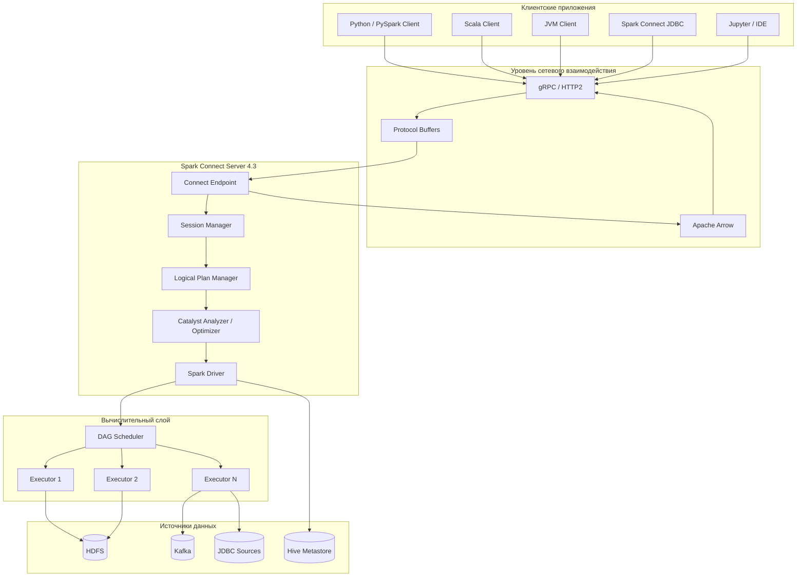
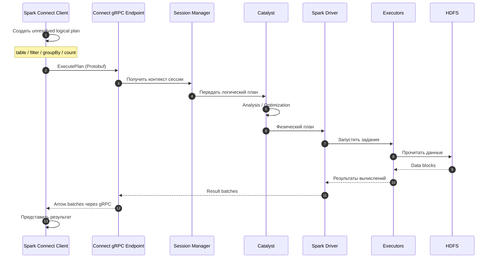
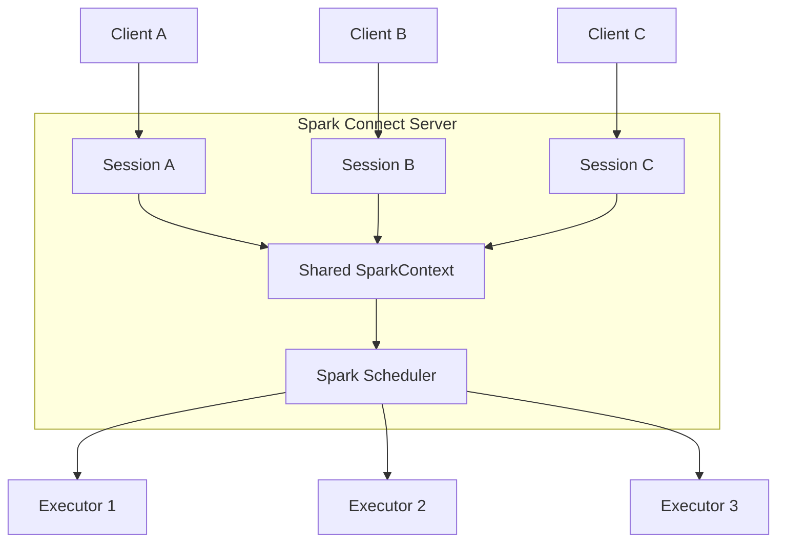
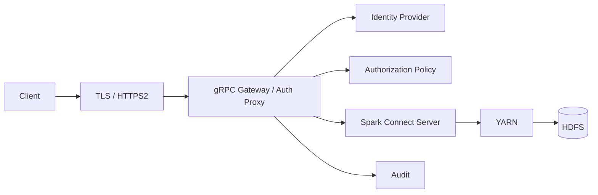
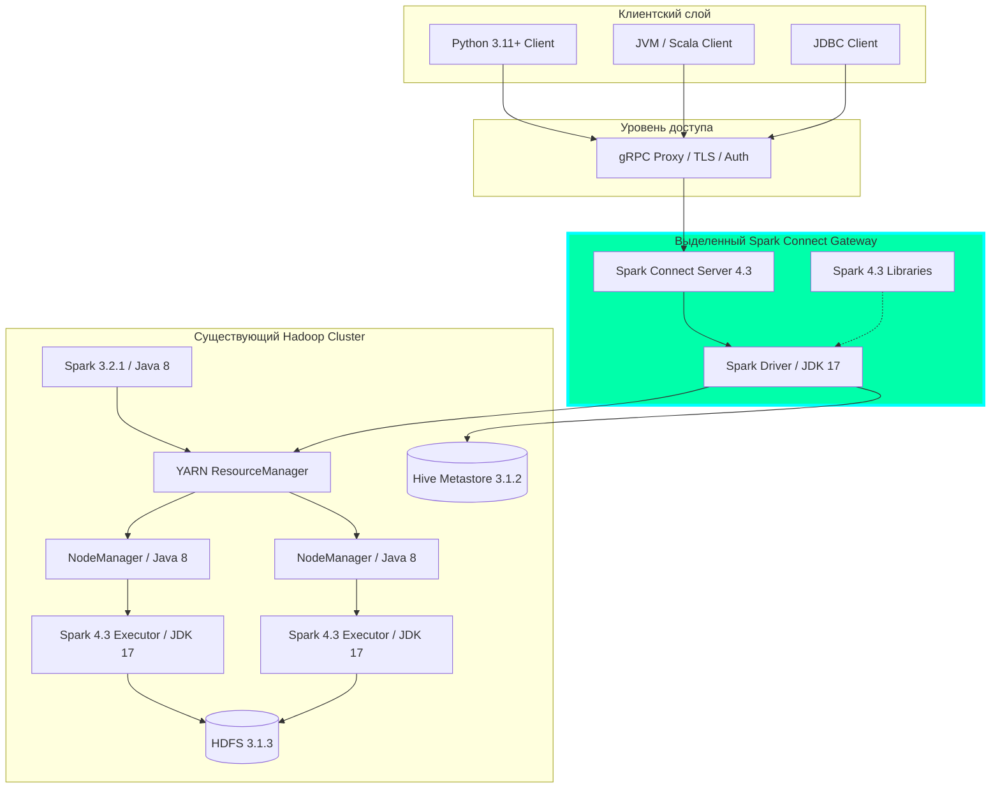

## 1. Что такое Apache Spark Connect 4.3

Apache Spark Connect — это клиент-серверный интерфейс Apache Spark, который позволяет приложениям удалённо выполнять SQL-запросы, операции DataFrame/Dataset и поддерживаемые операции Structured Streaming на Spark-кластере без размещения клиентского приложения внутри процесса Spark Driver.

Spark Connect появился в Apache Spark 3.4. В версии Spark 4.3.0 он представляет собой развитую архитектуру удалённого доступа, использующую:

- gRPC поверх HTTP/2 — для взаимодействия клиентов с сервером;
    
- Protocol Buffers — для передачи логических планов выполнения;
    
- Apache Arrow — для передачи результирующих наборов данных;
    
- Spark Catalyst — для анализа и оптимизации запросов;
    
- Spark SQL / DataFrame API — для описания вычислений;
    
- Spark Scheduler — для распределённого выполнения заданий.
    

Источник: [Apache Spark 4.3 — Spark Connect Overview](https://spark.apache.org/docs/4.3.0/spark-connect-overview.html?utm_source=chatgpt.com).

Основное отличие от классического Spark заключается в разделении клиентского приложения и серверного вычислительного окружения.

### 1.1. Сравнение Spark Classic и Spark Connect

|Характеристика|Spark Classic|Spark Connect 4.3|
|---|---|---|
|Архитектура|Клиентское приложение тесно связано со Spark Driver|Клиент-серверная|
|Протокол|Внутренние Spark API, RPC, Py4J для PySpark|gRPC + Protobuf|
|Формирование плана|На стороне Spark Driver|Unresolved plan формируется клиентом, анализируется сервером|
|Catalyst Optimizer|На Driver|На серверном Driver|
|DataFrame API|Есть|Есть|
|Spark SQL|Есть|Есть|
|Dataset API|Есть в Scala/Java|Поддерживается в Scala; Java API требует проверки отдельных методов|
|RDD API|Есть|Не поддерживается|
|SparkContext|Доступен|Недоступен клиенту|
|Structured Streaming|Есть|Поддерживается большая часть API|
|Удалённые приложения|Через Spark submission и клиентские механизмы|Через Spark Connect endpoint|
|Изоляция зависимостей|Клиент и Driver могут разделять runtime|Клиентские зависимости отделены от Driver|
|Независимое обновление клиента|Ограничено API и бинарной совместимостью|Возможно в пределах совместимости протокола|
|Несколько клиентских сессий|Есть механизмы отдельных сессий|Явная сессионная модель|

Важно: Spark Connect — не отдельный движок вычислений и не замена Catalyst, YARN или Spark Driver. Он предоставляет новый способ обращения к существующему механизму Spark.

### 1.2. Что нового именно в Spark 4.3

В Spark 4.3.0 появились следующие изменения Spark Connect.

|Возможность|Описание|Практическое значение|
|---|---|---|
|REST API для сессий|Просмотр сессий и операций|Операционный мониторинг|
|Operation IDs|Идентификаторы операций для сквозной трассировки|Корреляция запросов и логов|
|JDBC Driver|Улучшена работа со сложными типами и метаданными|BI и SQL-клиенты|
|`DataFrame.zip`|Поддержка операции через Connect|Расширение DataFrame API|
|`SQLContext` wrapper|Совместимость части старых SQL API|Упрощение миграции|
|Spark ML|Расширенная оценка размера кешируемых моделей|Управление ресурсами серверного ML|
|Persistent Local Connect|Повторное использование локального Connect Server|Ускорение циклов разработки|
|`foreachBatch`|Исправление передачи сессии|Корректность Streaming-приложений|
|gRPC KeepAlive|Настраиваемый контроль соединений|Устойчивость сетевых соединений|

Это подтверждено официальным списком изменений Spark 4.3, включая SPARK-57941, SPARK-58547, SPARK-57380 и SPARK-57787.

Apache Spark

## 2. Архитектура Spark Connect

### 2.1. Логическая архитектура



Диаграмма логическая: gRPC, Protobuf и Arrow являются механизмами одного канала взаимодействия, а не отдельными сетевыми сервисами. Catalyst, Driver и Session Manager также являются компонентами серверного Spark, а не независимыми узлами.

Источник: [Apache Spark — Connect Architecture](https://spark.apache.org/spark-connect/?utm_source=chatgpt.com).

### 2.2. Компоненты

Spark Connect Client — относительно лёгкая клиентская библиотека. Она предоставляет API, совместимый с поддерживаемым подмножеством Spark DataFrame/Dataset, и строит логические планы операций.

Spark Connect Endpoint — gRPC-сервис в серверном процессе Spark. Принимает планы, команды и запросы, передаёт их во внутренние подсистемы Spark, возвращает результаты.

Session Manager — управляет серверными сессиями клиентов. Сессия хранит контекст SQL, временные представления и настройки, которые имеют область действия сессии.

Catalyst Analyzer / Optimizer — разрешает имена таблиц и столбцов, проверяет типы, формирует оптимизированный логический план и участвует в создании физического плана.

Spark Driver — организует выполнение, взаимодействует с планировщиками, управляет заданиями и Executor.

Spark Executors — фактически выполняют распределённые вычисления.

Apache Arrow — применяется для эффективной передачи табличных результатов между сервером и клиентом.

### 2.3. Последовательность выполнения запроса

Рассмотрим запрос:

```
from pyspark.sql import SparkSession

spark = (
    SparkSession.builder
    .remote("sc://spark-connect.example.internal:15002")
    .getOrCreate()
)

df = (
    spark.table("analytics.events")
    .filter("event_type = 'ERROR'")
    .groupBy("service_name")
    .count()
)

df.show()
```

Последовательность:



При вызовах `table`, `filter`, `groupBy` и `count` как агрегирующего метода формируется описание вычислений. Фактическое исполнение запускается действием, например `show()`, `collect()` или записью данных.

Здесь важно различать `groupBy(...).count()` и `df.count()`: первый формирует агрегированный DataFrame, второй возвращает число строк и является действием.

## 3. Протокол Spark Connect

### 3.1. Уровни протокола

Application API

PySpark / Scala / JVM / JDBC

Spark Connect Protocol

Logical Plans, Commands, Sessions

Serialization

Protocol Buffers + Apache Arrow

Transport

gRPC over HTTP/2

Network

TCP / TLS (при соответствующей настройке)

Клиент не передаёт серверу готовый JVM-код для выполнения каждого SQL-запроса. Вместо этого он передаёт логическое описание операции, например `Read`, `Filter`, `Project`, `Aggregate`, `Join`.

Исполняемый пользовательский код, например UDF, является отдельным случаем и требует доставки зависимостей на сервер.

### 3.2. Unresolved Logical Plan

Рассмотрим:

```
df = (
    spark.read.parquet("hdfs:///data/events")
    .filter("status = 'FAILED'")
    .select("event_id", "timestamp")
)
```

Клиент формирует логическое описание, условно:

```
Project
 ├── event_id
 ├── timestamp
 └── Filter
      ├── status = 'FAILED'
      └── Read
           └── parquet("hdfs:///data/events")
```

При этом клиенту не обязательно иметь локальный доступ к HDFS. Путь анализирует и использует серверный Spark.

После получения плана Spark Server выполняет разрешение схем, анализ выражений, оптимизацию и построение физических операций.

### 3.3. Передача результатов

Результаты возвращаются клиенту последовательностью сообщений gRPC, содержащих Arrow-представление данных.

Это позволяет передавать табличные результаты без обязательного построчного преобразования через стандартные Python-объекты на сервере.

Однако крупный результат всё равно передаётся по сети и занимает память клиентского процесса. Spark Connect не устраняет ограничений `collect()` и `toPandas()`.

Для больших объёмов данных предпочтительна запись результата серверным Spark непосредственно в HDFS, Parquet или ORC с возвратом клиенту статуса операции.

Источник:

Spark 4.3.0 Documentation

.

## 4. Функциональность Spark Connect 4.3

### 4.1. DataFrame API

Spark Connect поддерживает основную часть операций DataFrame API.

|Категория|Возможности|Поддержка|
|---|---|---|
|Чтение|Parquet, ORC, JSON, CSV, JDBC|Да, при наличии серверных коннекторов|
|Фильтрация|`filter`, `where`|Да|
|Проекция|`select`, `withColumn`, `drop`|Да|
|Агрегации|`groupBy`, `agg`, `count`, `sum`|Да|
|Соединения|`join`, `crossJoin`|Да|
|Сортировка|`orderBy`, `sort`|Да|
|Оконные функции|`Window`, `row_number`, `rank`|Да|
|SQL|`spark.sql()`|Да|
|Запись|DataFrameWriter|Да|
|Кеширование|`cache`, `persist`|Да, серверное|
|Python UDF|Поддерживается|С ограничениями сериализации|
|RDD|`rdd`, `mapPartitions` через RDD|Нет|
|SparkContext|Доступ к `sc`|Нет|
|Внутренние JVM-объекты|`_jdf`, `_jvm` через Py4J|Нет|

Для отдельных методов актуальный статус можно проверить в [PySpark SQL API Reference](https://spark.apache.org/docs/4.3.0/api/python/reference/pyspark.sql/index.html?utm_source=chatgpt.com): поддерживаемые методы отмечены как `Supports Spark Connect`.

### 4.2. Пример: удалённая аналитика ORC

Для вашего кластера представляет интерес возможность запускать запросы к ORC на HDFS, не устанавливая Hadoop Client и библиотеки ORC на клиентскую машину.

```
from pyspark.sql import SparkSession
from pyspark.sql import functions as F

spark = (
    SparkSession.builder
    .remote("sc://spark-connect.example.internal:15002")
    .getOrCreate()
)

df = spark.read.format("orc").load(
    "hdfs:///data/events"
)

result = (
    df.filter(F.col("event_type") == "ERROR")
      .groupBy("service_name")
      .agg(
          F.count("*").alias("error_count"),
          F.max("event_timestamp").alias("last_error")
      )
      .orderBy(F.desc("error_count"))
)

result.show(20, truncate=False)
```

Исполнение происходит на стороне Spark Server и его Executors. Клиент получает только результат выборки, который запрашивает `show()`.

### 4.3. SQL API

Spark Connect поддерживает SQL-запросы непосредственно:

```
result = spark.sql("""
    SELECT
        service_name,
        COUNT(*) AS total_errors
    FROM analytics.events
    WHERE event_type = 'ERROR'
    GROUP BY service_name
    ORDER BY total_errors DESC
    LIMIT 100
""")

result.show()
```

SQL обрабатывает серверная версия Spark, а значит, Spark Connect Client может использовать SQL-функциональность Spark 4.3.

В частности, это могут быть `VARIANT`, `JSON_TABLE`, функции работы с массивами, новые оконные функции и другие возможности — при соблюдении соответствующих требований конфигурации.

### 4.4. Structured Streaming

Spark Connect поддерживает большую часть Structured Streaming API:

- `DataStreamReader`;
    
- `DataStreamWriter`;
    
- `StreamingQuery`;
    
- `StreamingQueryListener`;
    
- поддерживаемые stateful-операции.
    

Пример:

```
stream = (
    spark.readStream
    .format("rate")
    .option("rowsPerSecond", 100)
    .load()
)

query = (
    stream.writeStream
    .format("parquet")
    .option(
        "path",
        "hdfs:///user/spark43/output"
    )
    .option(
        "checkpointLocation",
        "hdfs:///user/spark43/checkpoints/rate-demo"
    )
    .outputMode("append")
    .start()
)
```

В данном примере использован тестовый источник `rate`, а не Kafka. Сервер должен иметь доступ к указанным HDFS-путям и права записи. Для производственного задания также следует определить правила владения checkpoint и жизненного цикла StreamingQuery.

Особенность — вычисления выполняются на сервере, но приложение-клиент использует удалённый объект для управления запросом. Необходимо проверить, как конкретное задание ведёт себя при отключении клиента, перезапуске серверного Driver и повторном подключении.

Поддержка streaming API не означает автоматической поддержки всех режимов Real-Time Mode в любой комбинации Spark Connect API и источников данных.

Источник:

Spark 4.3.0 Documentation

.

## 5. Управление сессиями

Spark Connect использует сессионную модель взаимодействия.

Несколько клиентских приложений могут подключаться к одному Spark Connect Server. Каждое получает контекст сессии, но вычислительные ресурсы одного серверного SparkContext могут оставаться общими.

### 5.1. Session isolation



У сессий могут быть собственные runtime SQL-настройки и временные представления. Но это не полная изоляция пользователей по ресурсам или безопасности: общий Driver, SparkContext, кеш и другие разделяемые компоненты создают необходимость в дополнительных мерах.

Для многопользовательского использования рекомендую разграничивать серверные экземпляры по доверенным группам пользователей или приложениям.

### 5.2. Важная особенность Lazy Analysis

Spark Connect откладывает не только физическое исполнение вычислений, но и часть анализа схем.

Например:

```
df = spark.sql("SELECT 1 AS id")
df = df.filter("unknown_column > 10")
```

Создание такого DataFrame может не завершиться ошибкой немедленно. Ошибка отсутствующего столбца появится при анализирующем запросе или действии:

```
df.show()
```

Это отличается от поведения ряда классических API Spark и влияет на диагностику приложений.

Документация также описывает отличия обращения к временным представлениям и сериализации UDF.

Spark 4.3.0 Documentation

.

## 6. Безопасность Spark Connect

Для промышленной эксплуатации безопасность является одним из главных архитектурных вопросов.

### 6.1. Базовые ограничения

Официальная документация указывает, что Spark Connect не предоставляет встроенную аутентификацию клиентов как готовый комплексный механизм. Для защиты интерфейса предполагается интеграция с внешней инфраструктурой аутентификации, например через прокси перед gRPC endpoint.

Spark 4.3.0 Documentation

.

Важные требования:

|Область|Рекомендация|
|---|---|
|Аутентификация|Корпоративный Identity Provider и аутентифицирующий прокси|
|Шифрование|TLS 1.2+ между клиентом и входным прокси|
|Авторизация|Отдельная проверка доступа к операциям, каталогам и данным|
|Сетевая изоляция|Не публиковать Connect Server напрямую в недоверенную сеть|
|Аудит|Сохранять client identity, session ID, operation ID, статус и длительность|
|Ресурсы|Ограничивать параллелизм, память, CPU, время выполнения|
|Результаты|Контролировать размер выдачи клиенту|
|Сессии|Устанавливать управляемую политику жизненного цикла|

### 6.2. Рекомендуемая схема безопасности



Здесь Gateway — предлагаемый архитектурный компонент, а не обязательная часть дистрибутива Apache Spark.

Он должен обеспечивать HTTP/2 и gRPC end-to-end, включая потоковую передачу ответов и корректную обработку продолжительных запросов.

Особенно важно: аутентификация клиента у Gateway не означает, что HDFS автоматически получит его Kerberos identity. Проброс и применение пользовательской идентичности должны проектироваться отдельно.

## 7. Настройки Spark Connect 4.3

Ниже основные параметры, подтверждённые официальной документацией.

|Параметр|Значение по умолчанию|Назначение|
|---|---|---|
|`spark.connect.grpc.binding.port`|`15002`|Порт gRPC|
|`spark.connect.grpc.binding.address`|Не задан|IP-адрес привязки|
|`spark.connect.grpc.port.maxRetries`|`0`|Попытки выбора другого порта|
|`spark.connect.grpc.maxInboundMessageSize`|`134217728`|Максимальный размер входящего gRPC-сообщения|
|`spark.connect.grpc.arrow.maxBatchSize`|`4m`|Целевой максимальный размер Arrow batch|
|`spark.connect.grpc.keepAlive.enabled`|`true`|Контроль живого соединения|
|`spark.connect.grpc.keepAlive.time`|`60s`|Интервал ожидания перед PING|
|`spark.connect.grpc.keepAlive.timeout`|`20s`|Ожидание ответа PING|
|`spark.connect.progress.reportInterval`|`2s`|Интервал сообщения о прогрессе|
|`spark.sql.connect.ui.retainedSessions`|`200`|Число сохраняемых записей о сессиях в UI|
|`spark.sql.connect.ui.retainedStatements`|`200`|Число сохраняемых записей об операциях в UI|

Источник: [Spark Connect Server Configuration](https://spark.apache.org/docs/4.3.0/configuration.html?utm_source=chatgpt.com#spark-connect).

Spark 4.3.0 Documentation

Пример конфигурации для внутреннего PoC:

```
spark.connect.grpc.binding.address=127.0.0.1
spark.connect.grpc.binding.port=15002

spark.connect.grpc.keepAlive.enabled=true
spark.connect.grpc.keepAlive.time=60s
spark.connect.grpc.keepAlive.timeout=20s

spark.connect.grpc.arrow.maxBatchSize=4m

spark.connect.progress.reportInterval=2s
```

Привязка к `127.0.0.1` предназначена для локального тестирования. Для удалённого доступа потребуется отдельное защищённое сетевое решение.

## 8. Развёртывание Spark Connect 4.3

### 8.1. Минимальный локальный PoC

Для простейшего запуска нужен отдельный сервер с Java 17 и Spark 4.3.0.

Согласно официальной документации, Spark 4.3.0 требует Java 17/21/25, Scala 2.13 и Python 3.11 или новее.

Spark 4.3.0 Documentation

На сервере:

```
export JAVA_HOME=/opt/jdk-17
export SPARK_HOME=/opt/spark43

export PATH=$JAVA_HOME/bin:$SPARK_HOME/bin:$PATH
```

Запуск Spark Connect Server:

```
$SPARK_HOME/sbin/start-connect-server.sh \
  --master "local[4]" \
  --conf spark.connect.grpc.binding.address=127.0.0.1 \
  --conf spark.connect.grpc.binding.port=15002
```

Проверить процесс и порт:

```
ps -ef | grep SparkConnect

ss -lnt | grep 15002
```

На клиентской машине с Python 3.11+:

```
python -m venv .venv

source .venv/bin/activate

pip install pyspark-client==4.3.0
```

Тестовый клиент:

```
from pyspark.sql import SparkSession

spark = (
    SparkSession.builder
    .remote("sc://localhost:15002")
    .getOrCreate()
)

print("Spark version:", spark.version)

result = spark.sql("""
    SELECT
        id,
        id * 10 AS value
    FROM range(10)
""")

result.show()

spark.stop()
```

Этот пример проверяет Spark Connect и локальный Spark 4.3, но не взаимодействие с Hadoop.

Официальная инструкция: [Spark Connect — Quick Start and Standalone Applications](https://spark.apache.org/docs/4.3.0/spark-connect-overview.html?utm_source=chatgpt.com).

## 9. Spark Connect 4.3 на вашем существующем Hadoop-кластере

Ваше исходное окружение:

```
versions:
  java: 1.8.0_292
  hadoop: 3.1.3.3.5.4.1-1
  spark: 3.2.1.3.5.4.1-1
  hive: 3.1.2.3.5.4.1-1
  tez: 0.9.1.3.5.4.1-1
  scala: 2.12.15
  orc_spark: 1.6.12
  orc_hive: 1.5.6
  orc_generator: 1.6.12
```

### 9.1. Ключевой момент совместимости

Spark Connect 4.3 нельзя использовать как способ заставить уже установленный Spark 3.2.1 выполнять функциональность Spark 4.3.

На серверной стороне должен работать именно Spark 4.3.0. Spark Connect Client отправляет логические планы, а анализ, оптимизацию и выполнение обеспечивает серверный Spark.

Spark 3.2.1 не содержит штатного Spark Connect Server: эта архитектура впервые появилась в версии 3.4.

Spark 4.3.0 Documentation

.

Следовательно, необходим отдельный Spark 4.3 runtime.

### 9.2. Предлагаемая архитектура



Это проектная архитектура, а не подтверждённая совместимая конфигурация.

Она предусматривает:

- независимый Spark Connect Server 4.3 на выделенном сервере;
    
- Java 17 для Spark Driver;
    
- существующий YARN для управления вычислительными ресурсами;
    
- Java 17 для Spark Executors, доставляемую через YARN Distributed Cache;
    
- сохранение системной Java 8 у Hadoop;
    
- доступ к существующему HDFS;
    
- подключение к Hive Metastore 3.1.2;
    
- сохранение Spark 3.2.1 без изменений.
    

Официальная документация Spark допускает запуск Spark 4.x на YARN с Hadoop старше ветки 3.5 при использовании отдельного JDK.

Spark 4.3.0 Documentation

.

### 9.3. Запуск Connect Server с YARN в client mode

Проверяемый вариант для PoC — размещение Spark Driver на выделенном сервере, а Executors в YARN.

Предположим, что Spark Connect Server запущен на сервере `spark-connect-gw`, где установлен JDK 17.

```
export JAVA_HOME=/opt/jdk-17
export SPARK_HOME=/opt/spark43

export HADOOP_CONF_DIR=/etc/hadoop/conf
export YARN_CONF_DIR=/etc/hadoop/conf
```

Подготовить архив JDK 17, содержащий каталог `jdk-17`, и поместить его в HDFS.

Затем выполнить экспериментальный запуск:

```
$SPARK_HOME/sbin/start-connect-server.sh \
  --master yarn \
  --deploy-mode client \
  --archives \
    hdfs:///user/spark43/runtime/jdk17.tar.gz#jdk17 \
  --conf spark.executorEnv.JAVA_HOME=./jdk17/jdk-17 \
  --conf spark.yarn.populateHadoopClasspath=false \
  --conf spark.executor.instances=2 \
  --conf spark.executor.cores=2 \
  --conf spark.executor.memory=2g \
  --conf spark.shuffle.service.enabled=false \
  --conf spark.dynamicAllocation.enabled=false \
  --conf spark.connect.grpc.binding.port=15002
```

Это конфигурация-кандидат для проверки. Не могу подтвердить, что `start-connect-server.sh` с такими параметрами будет успешно работать на вашем вендорском Hadoop 3.1.3.3.5.4.1-1. Необходимо убедиться, что сценарий запуска Spark Connect корректно передаёт аргументы `spark-submit`, создаёт Driver в client mode и удерживает доступный gRPC endpoint.

После запуска проверить:

1. Появилось ли приложение в YARN.
    
2. Создались ли Executors с Java 17.
    
3. Доступен ли gRPC-порт 15002.
    
4. Выполняется ли Spark SQL `SELECT 1`.
    
5. Работает ли чтение из HDFS.
    
6. Успешно ли чтение ORC.
    
7. Подключается ли Hive Metastore.
    
8. Корректно ли возвращаются результаты через Spark Connect Client.
    

В production этот сервер потребует отдельного управления жизненным циклом: сервисного менеджера, health checks, автоматического перезапуска, мониторинга и политики обслуживания активных сессий.

### 9.4. Почему для Connect предпочтителен YARN client mode

В обычном YARN cluster mode Driver размещается внутри YARN-контейнера. Его хост и жизненный цикл управляются YARN.

Для Spark Connect это усложняет предоставление стабильного сетевого endpoint клиентам.

В client mode Driver остаётся на выделенном сервере, а вычисления выполняются через YARN Executors. Благодаря этому проще обеспечить постоянное DNS-имя, фиксированный gRPC-порт, аутентифицирующий прокси и наблюдаемость.

Недостаток — выделенный сервер становится критичным компонентом, поэтому для высокой доступности необходимо проектировать восстановление сессий и обработку повторных запросов. Простое подключение нескольких Connect Servers к балансировщику не гарантирует перенос состояния сессии между Drivers.

## 10. Spark Connect JDBC Driver

Spark 4.3 также содержит улучшенный Spark Connect JDBC Driver.

В релизе расширена поддержка:

- сложных типов `ARRAY`, `MAP`, `STRUCT`;
    
- метаданных SQL-типов;
    
- primary key и foreign key metadata;
    
- операций получения результатов и работы с JDBC Statement;
    
- преобразования ошибок Spark Connect в `SQLException`.
    

Это важно для интеграции с Java-приложениями, аналитическими инструментами и SQL-клиентами.

Apache Spark

.

Но Spark Connect JDBC Driver и Spark Thrift Server — не одно и то же.

|Характеристика|Spark Connect JDBC|Spark Thrift Server|
|---|---|---|
|Серверный протокол|Spark Connect / gRPC|HiveServer2 / Thrift|
|Клиентский интерфейс|JDBC|JDBC/ODBC через совместимый драйвер|
|Основной сценарий|Подключение Java/BI-клиентов к Connect Server|SQL-доступ через HiveServer2-совместимый интерфейс|
|Требует Connect Server|Да|Нет|
|Совместимость со старыми BI-инструментами|Зависит от драйвера|Зависит от HiveServer2-совместимости|

Для нового Java-сервиса, которому необходимы только SQL-запросы, стоит отдельно сравнить Spark Connect JDBC и Spark Thrift Server. У них разные протоколы и особенности эксплуатации.

## 11. Производительность Spark Connect

Spark Connect сам по себе не ускоряет вычисления на Executors. Производительность серверной обработки определяется Spark SQL, Catalyst, ресурсами кластера, источниками данных и физическим планом запроса.

Однако клиент-серверная архитектура вводит дополнительные факторы.

|Операция|Особенность Spark Connect|
|---|---|
|Создание DataFrame|Формирование unresolved plan на клиенте|
|Доступ к схеме|Может вызывать дополнительный RPC|
|`show()`|Удалённое выполнение и возврат результата|
|`collect()`|Передача результата клиенту|
|`count()`|Распределённое вычисление на сервере|
|Запись ORC/Parquet|На сервере без передачи всех записей клиенту|
|Частые короткие запросы|Чувствительны к сетевой задержке|
|Длительные ETL|Дополнительные расходы протокола могут быть малой долей общего времени|

Из документации также следует, что частое обращение к `df.schema` или `df.columns` при построении большого количества промежуточных DataFrame способно создавать дополнительные запросы анализа на сервер.

Spark 4.3.0 Documentation

.

Для сравнения Spark Classic 4.3 и Spark Connect 4.3 рекомендую тестировать одинаковые вычисления при следующих сценариях:

|Тест|Метрика|
|---|---|
|`SELECT 1`|End-to-end latency P50/P95/P99|
|`SELECT ... LIMIT 100`|Время до первого результата|
|Сканирование ORC 10–100 ГБ|Время исполнения на кластере|
|`GROUP BY` и `JOIN`|Время выполнения, shuffle, spill|
|Возврат 1 тыс. / 100 тыс. строк|Сетевые накладные расходы|
|10 / 50 / 100 одновременных клиентов|Throughput, ошибки, память Driver|
|Разрыв клиентского соединения|Поведение операции и сессии|

Эти объёмы и уровни параллелизма — предлагаемые тестовые параметры, а не заявленные пределы Spark Connect.

## 12. Ограничения, важные для архитектуры приложений

### 12.1. Нет RDD и SparkContext

Spark Connect ориентирован на декларативные операции.

Например, следующий код не подходит:

```
df = spark.read.parquet("hdfs:///data/events")

rdd = df.rdd
```

Приложения, которые используют RDD API, прямые обращения к JVM или SparkContext, нельзя перенести на Spark Connect без переработки.

### 12.2. Удалённые UDF требуют контроля зависимостей

Scala/JVM-клиент может потребовать регистрации ClassFinder и загрузки артефактов в серверную сессию, например через `SparkSession.addArtifact`.

Необходимо проверять:

- сериализацию функций;
    
- бинарную совместимость;
    
- доступность JAR на сервере;
    
- загрузку классов на Executors;
    
- зависимость UDF от внешних библиотек.
    

Источник:

Spark 4.3.0 Documentation

.

### 12.3. Изоляция не равнозначна отдельному кластеру

Разные клиентские сессии могут разделять серверные вычислительные ресурсы. Для mission-critical эксплуатации необходимо контролировать распределение ресурсов и ограничения доступа независимо от механизма Spark Connect.

### 12.4. Версионная совместимость клиента и сервера

Spark Connect проектировался для независимой эволюции клиента и сервера, но это не гарантирует поддержку любой комбинации версий.

Для первого PoC я рекомендую Spark Connect Client 4.3.0 + Spark Connect Server 4.3.0.

После проверки можно отдельно тестировать совместимость клиентов других версий.

## 13. Рекомендуемая архитектура для вашего проекта

С учётом Hadoop 3.1.3, Spark 3.2.1, Hive 3.1.2, ORC и Java 8 оптимальным представляется следующий подход.

Целевая модель: Spark Connect как независимый сервис аналитических вычислений

Логическая схема предлагаемой конфигурации. Совместимость с вендорской сборкой необходимо подтвердить PoC.

### Что даёт такая архитектура

1. Сохранение существующего кластера. Hadoop, Hive, Tez, Java 8 и Spark 3.2.1 не требуется заменять.
    
2. Доступ к Spark 4.3. Новые приложения могут использовать SQL и DataFrame-функциональность Spark 4.3.
    
3. Изолированные клиентские приложения. Не требуется устанавливать полный Spark runtime на каждую клиентскую машину.
    
4. Единый управляемый вход. Можно централизовать аутентификацию, аудит, ограничения доступа и мониторинг.
    
5. Постепенная миграция. Spark 3.2.1 и Spark 4.3.0 могут сосуществовать, если их взаимодействие с YARN и хранилищами проходит испытания.
    

При этом Spark Connect не решает автоматически вопросы межверсийной совместимости Hadoop, Hive Metastore и ORC.

## 14. Итоговое заключение

Для вашего сценария Spark Connect 4.3 имеет смысл рассматривать прежде всего как отдельный сервис удалённого выполнения аналитических запросов и DataFrame-операций, а не как замену Spark 3.2.1.

Приоритетный вариант — выделенный Spark Connect Server 4.3 на Java 17, использующий существующие HDFS, Hive Metastore и, при успешной проверке, YARN для распределённых вычислений.

Для утверждения архитектуры потребуется подтвердить три ключевых условия: запуск Spark 4.3 Executors в вашем YARN, доступ Spark Connect Server к Hive 3.1.2 и совместимость существующих ORC-файлов.

### Основные официальные источники

- [Spark Connect Overview](https://spark.apache.org/docs/4.3.0/spark-connect-overview.html?utm_source=chatgpt.com)
    
- [Spark 4.3.0 Release Notes](https://spark.apache.org/releases/spark-release-4-3-0.html?utm_source=chatgpt.com)
    
- [Spark Configuration](https://spark.apache.org/docs/4.3.0/configuration.html?utm_source=chatgpt.com)
    
- [Spark Connect — Eager vs Lazy](https://spark.apache.org/docs/4.3.0/spark-connect-gotchas.html?utm_source=chatgpt.com)
    
- [Running Spark on YARN](https://spark.apache.org/docs/4.3.0/running-on-yarn.html?utm_source=chatgpt.com)
    
- [Spark Security](https://spark.apache.org/docs/4.3.0/security.html?utm_source=chatgpt.com)