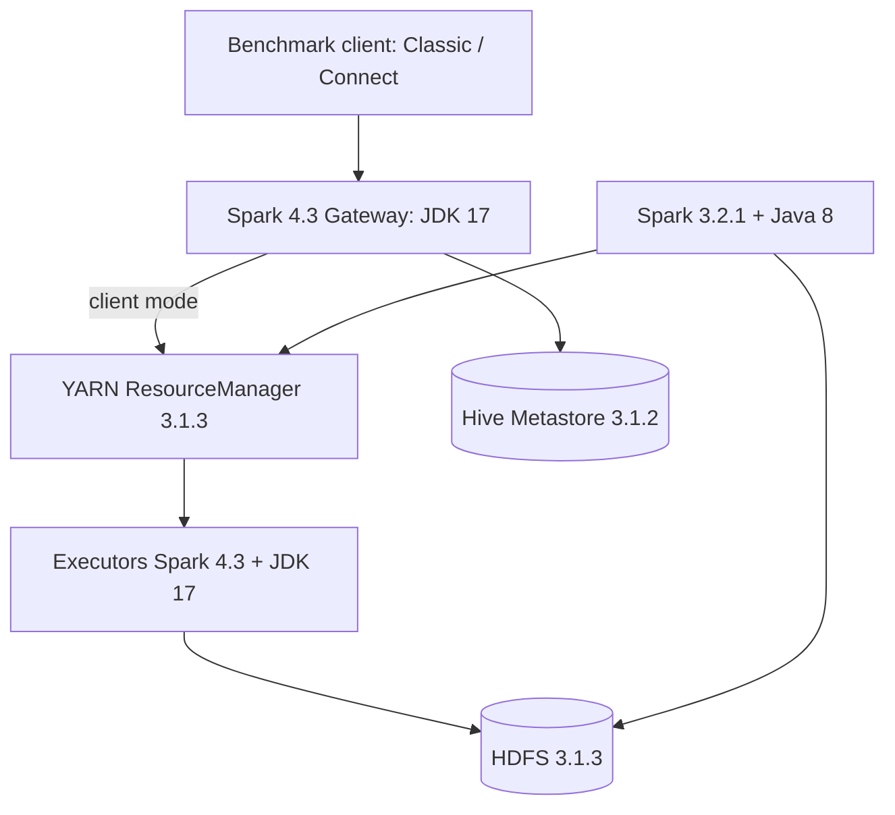
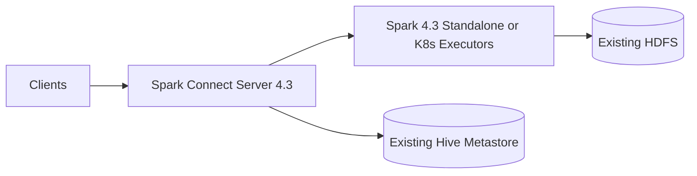
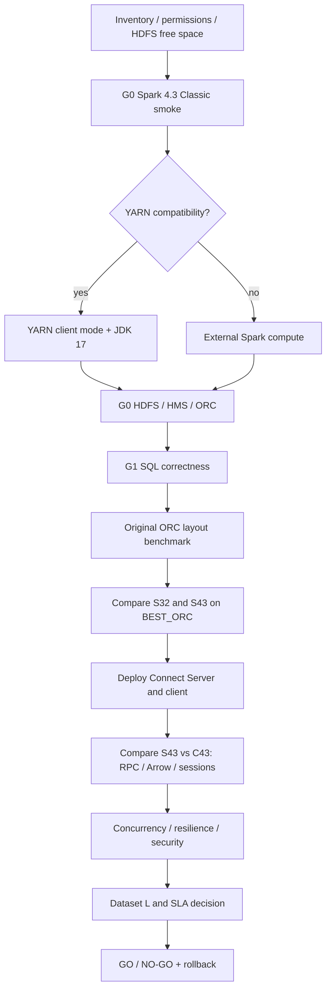

# План R&D и benchmark: ORC + HDFS + Spark 3.2.1 / 4.3.0 + Spark Connect 4.3 + Hive/Tez

> **Редакция:** 10.11.2026. **Статус:** проект методики; до испытаний результаты и совместимость НЕ подтверждены.  
> **Исходный документ:** «ORC + HDFS + Spark + Hive benchmark(3).md». Разделы 1–35 сохранены как историческая основа методики, дополнения — разделы 36–52.  
> **Базовый SLA исходного документа:** среднее время запроса ≤ 3 с. Дополнительно измеряются p95, p99, success rate и клиентская end-to-end latency.  
> **Важно:** строки про LLAP в исходной методике являются условным сценарием: LLAP в вашем кластере не установлен. Тесты LLAP не должны считаться доступными до отдельного согласованного развёртывания.

## Контекст существующего кластера

```yaml
versions:
  java: 1.8.0_292
  hadoop: 3.1.3.3.5.4.1-1
  orc_writer: null
  spark: 3.2.1.3.5.4.1-1
  hive: 3.1.2.3.5.4.1-1
  tez: 0.9.1.3.5.4.1-1
  llap: null
  scala: 2.12.15
  orc_spark: 1.6.12
  orc_hive: 1.5.6
  orc_generator: 1.6.12
```

**Развёртывание без обновления кластера:** Spark 3.2.1/Hive/Tez сохраняются; Spark 4.3.0 располагается в изолированном runtime c JDK 17, клиент Spark Connect — отдельно. Spark 4.3 on YARN — гипотеза, требующая проверки на вендорском Hadoop. Запасной вариант: внешний Spark Standalone/Kubernetes runtime с доступом к HDFS и Hive Metastore. Никаких глобальных замен системной Java/JAR/конфигурации Hadoop.

---

## 1. Итоговая карта вариантов для тестирования

Расширенный набор (исходные механизмы и новые тесты Spark 4.3 / Spark Connect):

|Уровень|Механизм|Что проверяем|Приоритет|
|---|---|---|--:|
|ORC|Column pruning|чтение только необходимых колонок|очень высокий|
|ORC|Predicate pushdown|передача фильтров в ORC reader|очень высокий|
|ORC|min/max statistics|skipping stripe/row group|очень высокий|
|ORC|Bloom Filter|`=`, `IN`|высокий|
|ORC|`row.index.stride`|детализация row-group index|средний/высокий|
|ORC|сортировка данных|увеличение эффективности min/max|очень высокий|
|ORC|`stripe.size`|размер единицы ORC scan|средний|
|ORC|compression|CPU ↔ I/O компромисс|средний|
|HDFS/Table|Partitioning|исключение файлов/директорий|очень высокий|
|HDFS/Table|Bucketing|JOIN/equality|выборочно высокий|
|HDFS|Compaction / small files|file-listing, scheduling, I/O|высокий|
|HDFS|Short-circuit read|локальный DataNode access|средний/высокий|
|HDFS|Centralized Cache|повторные запросы|высокий|
|Spark 3.2|Native/vectorized ORC reader|decode/CPU|высокий|
|Spark 3.2|AQE|shuffle/join/skew|высокий|
|Spark 3.2|DPP|partition pruning через JOIN|высокий|
|Spark 3.2|CBO/statistics|выбор плана|средний/высокий|
|Spark 3.2|Broadcast Join|исключение shuffle|высокий|
|Spark 4.3 Classic|ORC SQL regression / vectorized reader|совместимость форматов, скорость сканирования|очень высокий|
|Spark 4.3 Classic|AQE / DPP / CBO / Join|сравнение оптимизатора при равных ресурсах|очень высокий|
|Spark 4.3 Classic|SQL compatibility / ANSI / timestamps|совпадение результатов и контролируемые отличия|очень высокий|
|Spark Connect 4.3|gRPC / Protobuf / Arrow|клиентская overhead и передача результата|очень высокий|
|Spark Connect 4.3|sessions / concurrency / failures|надёжность удалённого доступа и SLA|очень высокий|
|Hive|Vectorized execution|CPU/decode|высокий|
|Hive|CBO/statistics|JOIN/order/plan|высокий|
|Hive|Tez|DAG execution, меньше промежуточного HDFS I/O|высокий|
|Hive ≥2.0|LLAP|persistent execution + ORC cache + I/O|очень высокий|
|Hive|Materialized Views|повторяющиеся aggregation queries|высокий для OLAP|


---

# 2. Что именно должно быть целью benchmark

Для SLA:

> **среднее время запроса ≤ 3 с**

главная метрика — не только `query duration`.

Нужно измерять минимум:

|Метрика|Зачем|
|---|---|
|AVG latency|ваш SLA|
|p50|типовая latency|
|p95|стабильность|
|p99|хвостовые задержки|
|HDFS bytes read|эффективность pruning|
|ORC rows read|эффективность pruning|
|partitions read|partition pruning|
|files opened|small-files overhead|
|CPU time|эффективность vectorization/compression|
|shuffle read/write|JOIN/GROUP BY|
|spilled bytes|дефицит памяти|
|records returned|нормализация результата|
|planning time|Hive/Spark optimizer overhead|
|execution time|собственно выполнение|
|cache hit ratio|LLAP/HDFS cache|

Ключевой KPI для ORC:

```text
Scan ratio =
physical bytes read
────────────────────
total bytes potentially accessible
```

Например:

```text
Partition = 200 GB
HDFS read = 800 MB

scan ratio = 800 MB / 200 GB
           ≈ 0.4 %
```

Чем ближе типовые selective queries к малым долям процента, тем реалистичнее SLA 3 секунды.

---

# 3. Не начинать со всех оптимизаций одновременно

Если сразу сделать:

```text
partitioning
+ sorting
+ bloom
+ stride=5000
+ vectorization
+ cache
+ AQE
```

и получить:

```text
20 s → 2.4 s
```

вы не узнаете, что именно дало результат.

Поэтому рекомендую схему:

```text
Baseline
   │
   ├─ + Optimization A
   │       ↓
   │     measure
   │
   ├─ + Optimization B
   │       ↓
   │     measure
   │
   ...
   │
   ▼
Best combination
```

---

# 4. Фиксированный тестовый dataset

Все тесты должны проводиться на **одном логическом dataset**.

Для вашего сценария разумная структура:

```text
event_date       DATE/TIMESTAMP

field_high       STRING   -- high cardinality
field_medium     STRING   -- medium cardinality
field_low        STRING   -- low cardinality

msg              STRING   -- ~1000 chars

id               STRING/BIGINT
```

Особенно важно сохранить **одно и то же распределение данных**, поскольку Bloom/min-max сильно зависят от cardinality и физического порядка значений.

Согласованные масштабы датасета (логически, по `dataset.yaml` / configs_final):

```text
Dataset S    ~100 GB    — layout-факторы, пилотный прогон
Dataset M    ~500 GB    — top-N подтверждение
Dataset L    ~1024 GB   — максимум; финальный SLA
```

Причём финальное решение по SLA принимать только по `L`. Между масштабами удаляйте ненужные физические копии layout’ов: каждый вариант — отдельный каталог на HDFS.

---

# 5. Набор эталонных запросов

Нужно сделать фиксированный query suite.

### Q1 — partition pruning

```sql
SELECT count(*)
FROM events
WHERE event_date = DATE '2026-09-01';
```

Проверяет:

```text
Partition pruning
+
ORC scan
```

---

### Q2 — equality high cardinality

```sql
SELECT event_date, field_high
FROM events
WHERE event_date = DATE '2026-09-01'
  AND field_high = 'VALUE_123456';
```

Проверяет:

```text
partition pruning
+
min/max
+
Bloom
+
sorting
```

Это один из наиболее важных benchmark-запросов.

---

### Q3 — equality medium cardinality

```sql
SELECT event_date, field_medium
FROM events
WHERE event_date = DATE '2026-09-01'
  AND field_medium = 'CATEGORY_123';
```

Проверяет эффективность Bloom при меньшей cardinality.

---

### Q4 — equality low cardinality

```sql
SELECT count(*)
FROM events
WHERE event_date = DATE '2026-09-01'
  AND field_low = 'ERROR';
```

Полезен для доказательства, что Bloom filter не обязательно эффективен на low-cardinality колонке.

---

### Q5 — `IN`

```sql
SELECT *
FROM events
WHERE event_date = DATE '2026-09-01'
  AND field_high IN ('A', 'B', 'C', 'D');
```

Основной сценарий Bloom.

---

### Q6 — range

Для числовой/date колонки:

```sql
SELECT count(*)
FROM events
WHERE event_time >= ...
  AND event_time < ...;
```

Проверяем:

```text
partition pruning
+
min/max
+
sorting
```

Bloom здесь не является основным механизмом.

---

### Q7 — column pruning

```sql
SELECT event_date, field_high
FROM events
WHERE event_date = DATE '2026-09-01';
```

против:

```sql
SELECT *
FROM events
WHERE event_date = DATE '2026-09-01';
```

Очень важно из-за большого `msg`.

---

### Q8 — aggregation

```sql
SELECT field_low, count(*)
FROM events
WHERE event_date = DATE '2026-09-01'
GROUP BY field_low;
```

Проверяет:

```text
scan
CPU
aggregation
shuffle
```

---

### Q9 — более тяжёлый GROUP BY

```sql
SELECT field_medium, count(*)
FROM events
WHERE event_date BETWEEN ...
GROUP BY field_medium;
```

Здесь уже интересно сравнивать:

```text
Spark AQE
vs
Hive/Tez
vs
Hive/LLAP
```

---

### Q10 — JOIN

Например:

```sql
SELECT e.field_medium, count(*)
FROM events e
JOIN dictionary d
  ON e.field_medium = d.id
WHERE e.event_date = DATE '2026-09-01'
  AND d.type = 'X'
GROUP BY e.field_medium;
```

Проверяет:

```text
Broadcast
AQE
DPP
CBO
Hive map join
```

---

# 6. Этап A — чистый ORC baseline

Создаём исходную таблицу:

```text
ORC
без Bloom
без sorting
row.index.stride = 10000
standard stripe
standard compression
```

Но без искусственного отключения штатных ORC indexes.

ORC изначально содержит lightweight indexes и способен пропускать row groups по predicates. Формат ORC появился в Hive 0.11 и с самого начала проектировался именно вокруг columnar storage и встроенных lightweight indexes. ([Apache Hive](https://hive.apache.org/docs/latest/language/languagemanual-orc/?utm_source=chatgpt.com "Apache Hive : LanguageManual ORC"))

Получаем:

```text
ORC-BASE
```

Это точка `T0`.

---

# 7. Этап B — Column pruning

Сравнить:

```sql
SELECT *
```

и:

```sql
SELECT field_high
```

при одном и том же `WHERE`.

Особенно показательным будет `msg ~1000 chars`.

Регистрировать:

```text
HDFS bytes read
CPU
query time
```

Spark 3.2 отдельно улучшил ORC column selection: release notes отмечают передачу списка требуемых columns в task configuration для уменьшения чтения ORC. ([Apache Spark](https://spark.apache.org/releases/spark-release-3-2-0.html?utm_source=chatgpt.com "Spark Release 3.2.0 | Apache Spark"))

---

# 8. Этап C — Predicate pushdown

Два варианта:

```text
C0 — pushdown OFF
C1 — pushdown ON
```

для Q2/Q3/Q5/Q6.

Проверить execution plan.

Для Spark:

```text
spark.sql.orc.filterPushdown
```

и native ORC reader.

Цель:

```text
C1 HDFS bytes read
        <
C0 HDFS bytes read
```

---

# 9. Этап D — Partitioning

Сделать три физические версии одной таблицы:

```text
D0 — no partitioning

D1 — PARTITIONED BY event_date

D2 — PARTITIONED BY event_date + hour
```

Но `D2` имеет смысл только если workload действительно активно работает с часовыми интервалами.

Тесты:

```text
Q1
Q2
Q3
Q6
Q8
```

Измерять:

```text
partitions selected
files selected
planning time
HDFS bytes
latency
```

---

# 10. Этап E — сортировка данных

Очень важный эксперимент.

Создать:

```text
E0
unsorted
```

```text
E1
sorted by field_high
```

```text
E2
sorted by field_medium
```

```text
E3
sorted by event_time, field_high
```

На Q2/Q3/Q6 сравнить:

```text
HDFS bytes read
row groups read
latency
```

Главный вопрос:

> насколько сортировка повышает эффективность встроенного min/max pruning?

---

# 11. Этап F — Bloom Filter

Создать четыре варианта:

```text
F0
Bloom OFF
```

```text
F1
Bloom(field_high)
```

```text
F2
Bloom(field_medium)
```

```text
F3
Bloom(field_high, field_medium, field_low)
```

ORC Bloom indexes поддерживаются начиная с Hive 1.2.0; на каждую указанную колонку создаётся `BLOOM_FILTER` stream с entry для каждой row group. ([Apache ORC](https://orc.apache.org/specification/ORCv2/?utm_source=chatgpt.com "Evolving Draft for ORC Specification v2"))

Тестировать:

```text
Q2 high
Q3 medium
Q4 low
Q5 IN
```

Собирать дополнительно:

```text
ORC size
index overhead
write time
```

Важно не только:

```text
query latency
```

но и:

```text
+5% storage?
+10%?
+20%?
```

---

# 12. Этап G — FPP Bloom Filter

Например:

```text
G1  FPP = 0.05
G2  FPP = 0.01
G3  FPP = 0.001
```

Стандартное значение текущего ORC:

```text
0.01
```

([Apache ORC](https://orc.apache.org/docs/spark-config.html?utm_source=chatgpt.com "Spark Configuration"))

Сравнить:

```text
index size
file size
query latency
false-positive efficiency
```

Я бы ожидал, что этот параметр даст меньший эффект, чем правильный выбор Bloom columns, но это нужно подтвердить benchmark.

---

# 13. Этап H — `row.index.stride`

Сделать:

```text
H1 = 5 000
H2 = 10 000
H3 = 20 000
H4 = 50 000
```

Default:

```text
10 000
```

([Apache ORC](https://orc.apache.org/docs/core-java-config.html?utm_source=chatgpt.com "ORC Java configuration"))

Тестировать прежде всего:

```text
Q2
Q3
Q5
```

Ожидаемая зависимость:

```text
stride ↓
   │
   ├─ точнее pruning
   ├─ больше indexes
   └─ больше metadata


stride ↑
   │
   ├─ меньше index overhead
   └─ более грубый pruning
```

---

# 14. Этап I — stripe size

Проверить, например:

```text
64 MB
128 MB
256 MB
```

Текущее default ORC:

```text
64 MiB
```

([Apache ORC](https://orc.apache.org/docs/core-java-config.html?utm_source=chatgpt.com "ORC Java configuration"))

Проверяются:

```text
selective scan
sequential scan
parallelism
metadata overhead
file size
```

Особенно важно не путать:

```text
ORC stripe size

и

ORC file size

и

HDFS block size
```

Это разные уровни.

---

# 15. Этап J — compression

Если версия ORC/Spark позволяет, сравнить минимум:

```text
ZLIB
SNAPPY
ZSTD
```

Spark 3.2 обновил bundled Apache ORC до **1.6.11** и добавил для ORC поддержку ZSTD/LZ4. ([Apache Spark](https://spark.apache.org/releases/spark-release-3-2-0.html?utm_source=chatgpt.com "Spark Release 3.2.0 | Apache Spark"))

Измерять:

```text
file size
HDFS bytes
decompression CPU
query latency
write latency
```

Это очень полезный benchmark:

```text
более сильная compression
       ↓
меньше HDFS I/O

но

больше CPU
```

При I/O-bound workload более сильная компрессия иногда ускоряет запрос.

---

# 16. Этап K — small files / compaction

Создать три layout:

```text
K1
много маленьких файлов
```

```text
K2
средние файлы
```

```text
K3
крупные файлы
```

Например benchmark-значения можно взять:

```text
~32 MB
~256 MB
~1 GB
```

Это **не рекомендация для production**, а удобные точки эксперимента.

Измерять:

```text
NameNode/file listing
planning
task count
HDFS open operations
query duration
```

---

# 17. Этап L — Spark ORC execution

После выбора лучшего физического ORC layout его фиксируем.

Получаем:

```text
BEST_ORC
```

Дальше не меняем данные и тестируем execution.

Для Spark 3.2:

```text
L0 native ORC, vectorized OFF

L1 native ORC, vectorized ON
```

Spark ORC native reader по умолчанию vectorized; Spark 3.2 добавил поддержку nested columns в ORC vectorized reader. ([Apache ORC](https://orc.apache.org/docs/spark-config.html?utm_source=chatgpt.com "Spark Configuration"))

---

# 18. Этап M — Spark AQE

Сравнить:

```text
M0 AQE OFF

M1 AQE ON
```

Запросы:

```text
Q8 GROUP BY
Q9 GROUP BY
Q10 JOIN
```

Spark **3.2 включил AQE по умолчанию**. В этой версии также улучшена интеграция Dynamic Partition Pruning с AQE и оптимизация skew join. ([Apache Spark](https://spark.apache.org/releases/spark-release-3-2-0.html?utm_source=chatgpt.com "Spark Release 3.2.0 | Apache Spark"))

Измерять:

```text
query time
shuffle bytes
shuffle partitions
spill
skew
physical plan
```

---

# 19. Этап N — Dynamic Partition Pruning

Использовать Q10 и partitioned fact table.

Сравнить:

```text
N0 DPP OFF
N1 DPP ON
```

Главная метрика:

```text
количество прочитанных partitions
```

и:

```text
HDFS bytes read
```

Spark 3.2 имеет специальные изменения по поддержке DPP совместно с AQE. ([Apache Spark](https://spark.apache.org/releases/spark-release-3-2-0.html?utm_source=chatgpt.com "Spark Release 3.2.0 | Apache Spark"))

---

# 20. Этап O — Spark CBO

Сначала:

```sql
ANALYZE TABLE ...
COMPUTE STATISTICS;

ANALYZE TABLE ...
COMPUTE STATISTICS FOR COLUMNS ...;
```

Затем:

```text
O0 CBO OFF
O1 CBO ON
```

Запросы:

```text
Q9
Q10
```

Проверяем не только latency:

```text
Join order
Join strategy
estimated rows
actual rows
```

---

# 21. Этап P — HDFS short-circuit read

Два режима:

```text
P0
short-circuit OFF
```

```text
P1
short-circuit ON
```

Но эксперимент имеет смысл только когда:

```text
Spark/Hive worker
и
DataNode

расположены совместно.
```

Сравнить:

```text
HDFS read latency
CPU
network
query time
```

---

# 22. Этап Q — HDFS Centralized Cache

Очень важен отдельный **cold/warm benchmark**.

```text
Q0
cold HDFS
```

```text
Q1
OS/HDFS naturally warmed
```

```text
Q2
HDFS Centralized Cache
```

Для всех следующих тестов обязательно явно писать:

```text
COLD
или
WARM
```

Иначе результаты LLAP/Spark/HDFS будут несопоставимы.

---

# 23. Теперь Hive baseline

После выбора одного:

```text
BEST_ORC
```

его надо читать одновременно Spark и Hive.

Получаем:

```text
             SAME ORC DATA
                   │
          ┌────────┴────────┐
          ▼                 ▼
       Spark 3.2          Hive
```

Это очень важно: **не создавать отдельные данные специально под Hive**, иначе benchmark потеряет чистоту.

---

# 24. Hive — первая конфигурация

Сначала:

```text
Hive + Tez
без LLAP
```

Я бы именно Tez использовал как baseline Hive для LLAP comparison.

Причина: LLAP сам по себе execution engine не является; официальная архитектура Hive описывает Tez AM как orchestrator, а части query исполняются LLAP daemons. ([Apache Hive](https://hive.apache.org/development/desingdocs/llap/?utm_source=chatgpt.com "Apache Hive : LLAP"))

Получаем:

```text
H0 = Hive + Tez
```

---

# 25. Hive Vectorization

Сравнить:

```text
H1
Hive/Tez
vectorization OFF
```

```text
H2
Hive/Tez
vectorization ON
```

Hive имеет:

```text
hive.vectorized.execution.enabled
```

с Hive 0.13.0. ([Apache Hive](https://hive.apache.org/docs/latest/admin/adminmanual-configuration/?utm_source=chatgpt.com "Apache Hive : AdminManual Configuration"))

Официальные Hive recommendations для Spark/Hive workloads также включают включение vectorized execution и CBO. ([Apache Hive](https://hive.apache.org/docs/latest/admin/hive-on-spark-getting-started/?utm_source=chatgpt.com "Apache Hive : Hive on Spark: Getting Started"))

---

# 26. Hive CBO

Собрать statistics:

```sql
ANALYZE TABLE ...
COMPUTE STATISTICS;

ANALYZE TABLE ...
COMPUTE STATISTICS FOR COLUMNS;
```

Hive хранит column statistics, включая:

```text
LOW_VALUE
HIGH_VALUE
NUM_NULLS
NUM_DISTINCTS
```

([Apache Hive](https://hive.apache.org/development/desingdocs/column-statistics-in-hive/?utm_source=chatgpt.com "Apache Hive : Column Statistics in Hive"))

Сравнить:

```text
HC0 Hive CBO OFF
HC1 Hive CBO ON
```

на:

```text
Q8
Q9
Q10
```

Hive CBO использует statistics, в частности для join ordering и выбора алгоритма JOIN. ([Apache Hive](https://hive.apache.org/docs/latest/user/cost-based-optimization-in-hive/?utm_source=chatgpt.com "Apache Hive : Cost-based optimization in Hive"))

---

# 27. Основной эксперимент — LLAP

Теперь:

```text
HL0
Hive + Tez
```

против:

```text
HL1
Hive + Tez + LLAP
```

LLAP появился в **Hive 2.0.0**. ([Apache Hive](https://hive.apache.org/development/desingdocs/llap/?utm_source=chatgpt.com "Apache Hive : LLAP"))

Архитектурно:

```text
HiveServer2
     │
     ▼
   Tez AM
     │
     ├─────────────┐
     ▼             ▼
LLAP daemon     YARN container
     │
     ├─ ORC cache
     ├─ metadata
     ├─ filter
     ├─ projection
     ├─ partial aggregate
     └─ selected joins
```

LLAP может выполнять filter, projection, transformations, partial aggregates, sorting, bucketing и некоторые joins. ([Apache Hive](https://hive.apache.org/development/desingdocs/llap/?utm_source=chatgpt.com "Apache Hive : LLAP"))

---

# 28. LLAP нужно тестировать минимум в двух состояниях

Это принципиально.

### LLAP Cold

```text
restart / clear LLAP cache

query
```

Получаем:

```text
Hive+LLAP cold
```

### LLAP Warm

```text
query
query
query
...
```

Получаем:

```text
Hive+LLAP warm
```

LLAP имеет специальный low-level ORC cache; конфигурация включает:

```text
hive.llap.io.enabled

hive.llap.io.cache.orc.size

hive.llap.io.memory.size
```

Эти параметры появились в Hive 2.0.0. ([Apache Hive](https://hive.apache.org/docs/latest/user/configuration-properties/?utm_source=chatgpt.com "Apache Hive : Configuration Properties"))

Поэтому одно измерение LLAP совершенно недостаточно.

---

# 29. LLAP cache-size benchmark

Проверить, например:

```text
25% hot working set
50%
100%
```

Не относительно всего 5-ТБ массива, а относительно **реального hot working set**.

Например:

```text
обычный запрос работает с 200 GB/day
```

тогда benchmark cache:

```text
50 GB
100 GB
200 GB
```

Главный вопрос:

> насколько latency становится стабильной при повторных interactive queries?

---

# 30. Обязательное финальное сравнение Spark и Hive

После всех локальных tuning experiments создать финальные профили.

Например:

```text
S0
Spark baseline
```

```text
S1
Spark optimized
```

```text
H0
Hive + Tez
```

```text
H1
Hive + Tez + vectorization + CBO
```

```text
H2
Hive + Tez + LLAP COLD
```

```text
H3
Hive + Tez + LLAP WARM
```

Все работают на **одних и тех же optimized ORC files**.

---

# 31. Финальная benchmark-матрица

Я бы свёл всё примерно к такой таблице:

|ID|Data layout|Engine|Optimization|
|---|---|---|---|
|B0|ORC baseline|Spark|baseline|
|B1|B0|Spark|column pruning|
|B2|B0|Spark|predicate pushdown|
|B3|partitioned|Spark|partition pruning|
|B4|sorted|Spark|min/max|
|B5|sorted|Spark|Bloom high|
|B6|sorted|Spark|Bloom high+medium|
|B7|sorted|Spark|stride 5k|
|B8|sorted|Spark|stride 10k|
|B9|sorted|Spark|stride 20k|
|B10|optimized|Spark|vectorized|
|B11|optimized|Spark|AQE|
|B12|optimized|Spark|DPP|
|B13|optimized|Spark|CBO|
|B14|optimized|Spark|HDFS short-circuit|
|B15|optimized|Spark|HDFS cache|
|H0|optimized|Hive/Tez|baseline|
|H1|optimized|Hive/Tez|vectorized|
|H2|optimized|Hive/Tez|vectorized + CBO|
|H3|optimized|Hive/Tez/LLAP|cold|
|H4|optimized|Hive/Tez/LLAP|warm|

Это уже достаточно управляемое количество конфигураций.

---

# 32. Но каждый вариант надо прогнать много раз

Один запуск не считается benchmark.

Для каждой пары:

```text
configuration × query
```

я бы делал:

```text
3–5 warm-up
+
20–30 measured executions
```

Для очень тяжёлых запросов можно уменьшить количество, но для целевого SLA в 3 секунды 20–30 наблюдений вполне оправданы.

Не усреднять cold и warm вместе.

---

# 33. Concurrency benchmark

После single-query теста обязательно:

```text
1 concurrent query

5

10

25

50
```

или до фактической ожидаемой нагрузки.

Получаем матрицу:

|Engine|Concurrent|AVG|p50|p95|p99|
|---|--:|--:|--:|--:|--:|
|Spark|1|||||
|Spark|5|||||
|Spark|10|||||
|Hive/LLAP|1|||||
|Hive/LLAP|5|||||
|Hive/LLAP|10|||||

LLAP как раз рассчитан на concurrent interactive workload: daemon позволяет параллельно исполнять fragments нескольких queries/sessions. ([Apache Hive](https://hive.apache.org/development/desingdocs/llap/?utm_source=chatgpt.com "Apache Hive : LLAP"))

---

# 34. Я бы добавил отдельный SLA-показатель

Для каждого варианта:

```text
SLA Success Rate =
queries with latency <= 3 sec
───────────────────────────
all queries
× 100 %
```

Например:

```text
AVG = 2.4 s
p95 = 7.8 s
SLA success = 83 %
```

Такой результат я бы **не считал удовлетворительным**, несмотря на среднее меньше трёх секунд.

Полезнее получить:

```text
AVG       = 1.7 s
p95       = 2.6 s
p99       = 3.5 s
<=3 s     = 98.4 %
```

Тогда характер поведения системы виден гораздо лучше.

---

## 35. Итоговая последовательность R&D

Получается такой pipeline:

```text
PHASE 1
ORC baseline
     │
     ▼
PHASE 2
Partitioning
     │
     ▼
PHASE 3
Sorting
     │
     ▼
PHASE 4
Bloom
     │
     ▼
PHASE 5
stride / stripe / compression
     │
     ▼
PHASE 6
Compaction
     │
     ▼
 BEST PHYSICAL ORC
     │
     ├───────────────────────────┐
     ▼                           ▼
PHASE 7                     PHASE 8
Spark 3.2                   Hive/Tez
vectorized                  vectorized
AQE                         CBO
DPP                            │
CBO                            ▼
     │                     Hive/LLAP
     │                     cold/warm
     │                           │
     └──────────────┬────────────┘
                    ▼
                 PHASE 9
           concurrency benchmark
                    │
                    ▼
                 PHASE 10
              SLA ≤ 3 sec
```

Базовый принцип исходной методики — **сначала найти оптимальную физическую организацию ORC один раз, а затем на совершенно одинаковых ORC-файлах сравнить Spark 3.2 и Hive/Tez**; в новой редакции также сравниваются Spark 4.3 Classic и Spark Connect 4.3 (см. разделы 36–52). Тогда можно будет корректно ответить отдельно на два вопроса: сколько ускорения даёт сам правильный ORC-layout и сколько дополнительно даёт query engine/LLAP.

И я бы особо выделил **Hive 2.0.0 как минимальную версию для LLAP**, но если задача — реально проводить R&D сейчас, версию Hive надо выбирать не просто «≥2.0», а исходя из совместимости с вашим Hadoop/YARN/Tez-стеком. Сам факт появления LLAP в 2.0.0 подтверждён официальной документацией Apache Hive. ([Apache Hive](https://hive.apache.org/development/desingdocs/llap/?utm_source=chatgpt.com "Apache Hive : LLAP"))

---

## 36. Новый контур исследований: что именно сравнивается

Добавляются **три независимых вычислительных профиля** и один существующий Hive-профиль:

| Код | Клиент / API | Сервер и execution | Назначение |
|---|---|---|---|
| `S32` | Spark Classic 3.2.1 | существующий Spark 3.2.1 на YARN | референсная производительность |
| `S43` | Spark Classic 4.3.0 | отдельный Spark Driver 4.3 + Executors 4.3 | изменение версии движка |
| `C43` | Spark Connect Client 4.3.0 | **тот же серверный Spark 4.3**, через gRPC | протокольные и сессионные накладные расходы |
| `H31` | Beeline/JDBC | Hive 3.1.2 + Tez 0.9.1 | существующая альтернатива SQL |
| `HL` | Hive + LLAP | отсутствует | **не выполнять**, пока LLAP не развёрнут отдельно |

**Контрольный принцип:** `S43` и `C43` должны иметь одинаковые версии библиотек, конфигурацию SQL, вычислительные ресурсы, JDK, ORC layout и доступ к данным. Отличается только способ доступа. Иначе невозможно вычислить стоимость Spark Connect.

Не смешивать метрики «время SQL-движка» и «полное время клиента»: у `C43` отдельно измеряются построение плана на клиенте, RPC, анализ и планирование, выполнение на Executors, сериализация Arrow и доставка результата. На практике разделение на эти стадии часто приблизительно: тайминги в клиенте + Spark event logs + метрики gRPC, не выдавать разницу за точный server processing time.

### 36.1. Две самостоятельные гипотезы

**H-ENGINE:** Spark Classic 4.3 ускоряет Q1–Q10 по сравнению с Spark Classic 3.2.1 при неизменных данных и ресурсах. Проверка: `S43` против `S32`.

**H-CONNECT:** Spark Connect 4.3 добавляет приемлемые накладные расходы к Spark Classic 4.3 при одинаковом серверном плане и объёме результата. Проверка: `C43` против `S43`.

Никаких заранее обещанных процентов ускорения. При изменениях физических планов выгоду или регрессию фиксировать вместе с `EXPLAIN FORMATTED` и Spark UI.

## 37. Гейт G0: проверка совместимости без изменения существующего кластера

**До нагрузочных испытаний обязателен compatibility smoke-test.** Иначе результаты тестов ORC и Spark Connect не имеют ценности.

| ID | Проверка | Результат успешного теста | Если не прошла |
|---|---|---|---|
| G0-01 | Spark 4.3 + JDK 17 на выделенном gateway | `spark-submit --version`; Java 17 | проверить runtime/JAR |
| G0-02 | Spark 4.3 Classic local mode | SparkPi/SQL `SELECT 1` | остановить дальнейшие тесты |
| G0-03 | Spark 4.3 YARN client mode | Driver вне YARN, Executors внутри YARN | перейти к отдельному compute-контруру |
| G0-04 | Доставка JDK 17 через YARN Distributed Cache | Driver / AM / Executors используют требуемую Java | исправить окружение контейнеров |
| G0-05 | Чтение тестового HDFS-каталога | read + count совпадает с эталоном | проверить Hadoop client / delegation tokens |
| G0-06 | Запись в **выделенный** тестовый путь HDFS | read-after-write; без изменения production-файлов | разбор прав и конфигурации |
| G0-07 | Hive Metastore 3.1.2 | чтение схем и партиций read-only | изолированный Hive Metastore client |
| G0-08 | ORC 1.5.6/1.6.12 | чтение всех поддерживаемых типов без расхождений | несовместимость reader/SerDe — стоп |
| G0-09 | Spark Connect server | gRPC endpoint доступен только из тестовой сети | диагностика сервера / сети |
| G0-10 | Spark Connect Client 4.3 | `SELECT 1`, `range(100)`, `count` | проверить клиентские зависимости |
| G0-11 | Kerberos / прокси / access control (если используется) | корректные права на каталоги, токены, аудит | запрет multi-user тестов |
| G0-12 | Совместный запуск S32 + S43 | не нарушает штатные Spark 3.2 / Hive процессы | изоляция очередей и ресурсов |

**Java/Scala:** системная Java 8 и Scala 2.12.15 сохраняются; Spark 4.3 требует отдельный совместимый JDK (минимум 17) и Scala 2.13 для сборки Scala-приложений. Для Python-клиентов использовать версию Python, поддерживаемую Spark 4.3. Для чистого Spark Connect Python не требуется локальный Hadoop client. Сборка Hadoop у вас вендорская; для неё нельзя заранее гарантировать совместимость.

### 37.1. Допустимые архитектуры запуска



Если G0-03 не выполнен, **резервная архитектура**:



Для честного сравнения `S43` и `C43` в резервной архитектуре необходимо использовать **один и тот же внешний compute**. При сравнении с `S32` отдельно обозначать различие менеджеров ресурсов (YARN против Standalone/K8s) как смешивающий фактор.

**Источники:** [Spark 4.3 Running on YARN](https://spark.apache.org/docs/4.3.0/running-on-yarn.html), [Spark 4.3 Hive Tables](https://spark.apache.org/docs/4.3.0/sql-data-sources-hive-tables.html).

## 38. Гейт G1: SQL и бинарная совместимость

| ID | Объект | Проверяемые сценарии | Критерий |
|---|---|---|---|
| G1-01 | ORC primitives | STRING, BIGINT, DOUBLE, BOOLEAN | значения совпадают |
| G1-02 | ORC DECIMAL | precision/scale, overflow | совпадает либо отличие задокументировано |
| G1-03 | DATE/TIMESTAMP | UTC и иная timezone, старые значения | совпадают ожидаемые instant/date |
| G1-04 | NULL | joins, aggregation, `IN`, NULL predicates | семантическое совпадение |
| G1-05 | ANSI | `spark.sql.ansi.enabled=true/false` | ожидаемые ошибки/результаты |
| G1-06 | ORC nested | STRUCT, ARRAY, MAP, nullable nested | схема и значения |
| G1-07 | ORC codecs | SNAPPY, ZLIB, ZSTD (если читатель поддерживает) | читается каждым заявленным читателем |
| G1-08 | Hive ORC | чтение созданных Hive 3.1.2 таблиц | read-only; `COUNT`, schema, partition |
| G1-09 | Spark 4.3 ORC write | собственный sandbox каталог | читается Spark 4.3; чтение Hive — отдельный гейт |
| G1-10 | DataFrame / SQL parity | те же Q1–Q10 | результаты и типы совпадают |
| G1-11 | UDF/JAR | существующие UDF, Scala ABI | старые JAR не используются без пересборки |
| G1-12 | Cache / checkpoint | независимые версии и директории | исключён общий mutable state |

Для регрессии использовать не только `COUNT(*)`, но и checksum результата по **канонической сериализации** полей (включая `NULL`, типы и timestamp). Порядок строк без `ORDER BY` незначим; некорректно сравнивать списки в произвольном порядке. Не полагаться на одинаковые raw hashes разных сериализаторов без единой схемы нормализации.

Протокол различий: `query_id`, исходный SQL, Spark version, SQLConf, timezone, schema, count, checksum, samples, exception class. Для вычислений с FLOAT/DOUBLE задавать допустимую числовую погрешность и фиксировать алгоритм сравнения.

## 39. Матрица запусков Q1–Q10: Spark 3.2, Spark 4.3, Spark Connect

На идентичных `ORC-BASE` и `BEST_ORC` выполнить:

| Query | S32 Classic | S43 Classic | C43 Connect | H31 Hive+Tez | Цель |
|---|---|---|---|---|---|
| Q1 partition | ✓ | ✓ | ✓ | ✓ | partition pruning |
| Q2 high eq | ✓ | ✓ | ✓ | ✓ | min/max / Bloom |
| Q3 medium eq | ✓ | ✓ | ✓ | ✓ | Bloom |
| Q4 low eq | ✓ | ✓ | ✓ | ✓ | selectivity |
| Q5 IN | ✓ | ✓ | ✓ | ✓ | index / projection |
| Q6 time range | ✓ | ✓ | ✓ | ✓ | timestamp min/max |
| Q7 projection | ✓ | ✓ | ✓ | ✓ | column pruning, Arrow transfer |
| Q8 aggregation | ✓ | ✓ | ✓ | ✓ | aggregations |
| Q9 medium GROUP BY | ✓ | ✓ | ✓ | ✓ | AQE / shuffle |
| Q10 JOIN | ✓ | ✓ | ✓ | ✓ | DPP / AQE / broadcast |

**Дополнительные Q11–Q17 — только после G0/G1:**

- `Q11_SMALL`: `SELECT 1`, `SELECT * FROM ... LIMIT 1`; baseline RPC/планирования;
- `Q12_RESULT`: идентичный запрос с `LIMIT 10/1000/100000` и контролем bytes returned; измерять `show`, `collect`, серверную запись отдельно;
- `Q13_JSON`: `parse_json` / `VARIANT` на тестовом столбце JSON; `S32` использовать эквивалентную legacy-операцию с отдельной пометкой «неидентичный SQL»; не включать в прямой speedup;
- `Q14_METADATA`: `spark.table`, `schema`, `columns`, `EXPLAIN`; число дополнительных RPC;
- `Q15_CACHE`: идентичный агрегирующий запрос cold/warm/cache, кэш **на сервере**;
- `Q16_SESSION`: несколько независимых временных view/SQLConf в Spark Connect sessions;
- `Q17_WRITE`: запись 1–10 GB в **новые** ORC/Parquet test directories с проверкой checksum.

Для `C43` выполняйте SQL через `spark.sql(...)` на сервере 4.3. Если нужен отдельный DataFrame API тест, выполняйте эквивалентную цепочку `read→filter→groupBy→agg→orderBy`, сохраняйте отдельную категорию `C43-DF`. Не сравнивать количество RPC по разным планам без анализа query plan.

### 39.1. Пример запроса для проверки результата

```sql
SELECT event_date, field_low, COUNT(*) AS n
FROM events
WHERE event_date = DATE '2026-09-01'
GROUP BY event_date, field_low
ORDER BY event_date, field_low;
```

Для фиксированного множества ключей сравните количества и значения `n`. Сами Q1–Q10 остаются в разделах 5–20 исходной методики.

## 40. Изолированное тестирование Spark 4.3 execution (новые опыты)

После выбора `BEST_ORC` и при одинаковых входных файлах:

| ID | Изменяемый фактор | OFF / ON / варианты | Тесты | Собираемые данные |
|---|---|---|---|---|
| S43-L | native/vectorized ORC | vectorized false/true | Q2/Q7/Q8 | bytes, CPU, plan |
| S43-M | AQE | false/true | Q8–Q10 | shuffle, skew, latency |
| S43-N | Dynamic Partition Pruning | false/true | Q10* | partitions, bytes |
| S43-O | CBO | false/true + statistics | Q9/Q10 | join strategy, plan |
| S43-B | Broadcast threshold | autoBroadcastJoinThreshold = -1 / chosen threshold | Q10 | shuffle, memory |
| S43-F | ORC pushdown | false/true | Q2–Q6 | pushed filters / HDFS bytes |
| S43-ANSI | ANSI mode | false/true | SQL regression | errors, schema, result |
| S43-CODEC | ORC codec | snappy/zstd (write only sandbox) | Q7/Q8/Q17 | size, CPU, duration |

`*` Для настоящей проверки DPP ключ JOIN должен участвовать в partition pruning целевой факт-таблицы. **Исходный Q10 соединяет по `field_medium`, а факты партиционированы по `event_date`: такой Q10 сам по себе не гарантирует проявления DPP.** Подготовить вариант `Q10_DPP` с таблицей, физически партиционированной по JOIN-ключу, или соединением по partition key. Сравнивать число выбранных партиций.

Не включать сразу все оптимизации. Сначала **one-factor-at-a-time**, затем несколько лучших сочетаний и повторная проверка взаимодействий. Каждый прогон фиксирует фактические effective `spark.sql.*` настройки через Spark UI / `SET -v` / конфигурационный снимок.

**Источники:** [Spark 4.3 Configuration](https://spark.apache.org/docs/4.3.0/configuration.html), [Spark 4.3 ORC](https://spark.apache.org/docs/4.3.0/sql-data-sources-orc.html), [SQL Migration Guide](https://spark.apache.org/docs/4.3.0/sql-migration-guide.html).

## 41. Spark Connect 4.3 — отдельная методика benchmark

**Протокольная архитектура**: Spark Connect Client строит unresolved logical plan → сериализация Protobuf → gRPC → server Spark 4.3 → Catalyst/Executors → Arrow batches через gRPC. Сравнивать Connect с Classic нужно **на одном и том же Spark 4.3**. Источник: [Spark Connect Overview](https://spark.apache.org/docs/4.3.0/spark-connect-overview.html).

### 41.1. Условия сравнения

1. Одинаковый физический ORC layout, версия Spark 4.3, SQLConf, драйвер, executor pool, параллелизм и query suite.
2. Spark Classic benchmark client расположен максимально близко к Driver; Spark Connect client запускается **а)** на том же сервере/сегменте и **б)** в целевой пользовательской сети.
3. Для прогонов с сетевым прокси отдельно измерять «Connect direct in trusted test network» и «Connect via TLS/auth gateway»; не смешивать.
4. Объёмы результатов — `0`, `1`, `10`, `1000`, `100000` строк **при одинаковой ширине схемы**. Число строк недостаточно; обязательно `result_bytes`.
5. `count` и серверная запись исключают массовую передачу результата; `collect` / `toPandas` / Arrow stream измеряются отдельно.

### 41.2. Набор экспериментов Spark Connect

| ID | Эксперимент | Что изменяем | Основная метрика |
|---|---|---|---|
| C01 | Connect setup | новый клиент / повторно используемый клиент | connect/session initialization latency |
| C02 | Micro SQL | `SELECT 1` / `range(1)` | end-to-end RTT |
| C03 | Small query | Q1/Q2/`LIMIT 1` | Spark time vs client latency |
| C04 | Full Q1–Q10 | `S43` vs `C43` | overhead, p50/p95/p99 |
| C05 | Result size | 0/1/10/1k/100k; фиксированный payload | bytes/s, serialization |
| C06 | Columns / types | narrow vs wide, nested, nullable, `msg` | Arrow memory/latency |
| C07 | SQL vs DataFrame | Spark SQL vs эквивалентный Connect DataFrame plan | RPC count, plan equality |
| C08 | Schema metadata | `df.schema`, `df.columns`, `explain` | число RPC и latency |
| C09 | Server-side write | ORC/Parquet path, без возврата строк | write throughput |
| C10 | Warm/cold sessions | новая сессия / переиспользованная | session overhead |
| C11 | Cache | uncached / cached (сервер) | query latency, eviction |
| C12 | Concurrency | 1/5/10/25/50 clients | throughput/errors/queue |
| C13 | Network | LAN, target WAN, + latency injection где разрешено | RTT sensitivity |
| C14 | TLS/auth proxy | direct / proxy | latency, gRPC errors |
| C15 | Keepalive | idle reconnect / stable connection | disconnects/reconnect latency |
| C16 | Session isolation | параллельные временные view и SQLConf | отсутствие взаимных конфликтов |
| C17 | Failure injection | disconnect client, restart server, kill executor | recovery, errors, orphan jobs |
| C18 | Backpressure | выдача результата медленному клиенту | buffer/memory, timeouts |
| C19 | Many plans | 100/1000 последовательных мелких запросов | driver CPU, metadata memory |
| C20 | Streaming* | rate/Kafka supported operations | latency, checkpoint behavior |

`*` Streaming является отдельным функциональным PoC; не включать его в единый Q1–Q10 SLA и не предполагать поддержку всех режимов Real-Time/Stateful API через конкретный Connect клиент без теста.

### 41.3. Сетевые и серверные настройки, фиксируемые в протоколе

```properties
# Spark Connect 4.3 (параметры сервера; значения для PoC)
spark.connect.grpc.binding.port=15002
spark.connect.grpc.maxInboundMessageSize=134217728
spark.connect.grpc.arrow.maxBatchSize=4m
spark.connect.grpc.keepAlive.enabled=true
spark.connect.grpc.keepAlive.time=60s
spark.connect.grpc.keepAlive.timeout=20s
```

Параметры проверить по действующей сборке Spark; ограничения сообщения и Arrow batch **не равны** ограничению общего размера DataFrame/результата. Источник: [Spark 4.3 Configuration — Spark Connect](https://spark.apache.org/docs/4.3.0/configuration.html#spark-connect).

## 42. Метрики и точки измерения для Spark Connect


`t0–t5` — **логические метки для собственной инструментализации**; они не являются автоматически доступными точными timestamp Spark Connect.

| Метрика | Источник | Комментарий |
|---|---|---|
| `client_total_ms` | monotonic clock client | `execute + full materialization` при `collect` |
| `client_first_result_ms` | клиентский измеритель | до первой полученной порции, если API позволяет |
| `session_init_ms` | клиент | отдельно от SQL latency |
| `server_sql_ms` | Spark UI/event log/SQL metrics | планирование и выполнение; не всегда строго совпадает с сетевым окном |
| `grpc_message_count` | gRPC client/server instrumentation | направление и тип RPC |
| `grpc_payload_rx_bytes` | прокси/инструментация | размер фактического ответа |
| `arrow_decode_ms` | профилирование клиента | только если доступно |
| `driver_heap/gc_ms` | JVM JMX/metrics | при concurrency |
| `executor_cpu/memory/spill` | Spark event log/metrics | сравнивать с `S43` |
| `hdfs_bytes_read` | HDFS / Spark FS metrics | различать логическое/физическое чтение |
| `connection_errors / grpc_status` | клиент/прокси | UNAVAILABLE, DEADLINE_EXCEEDED и др. |
| `active_sessions / active_operations` | сервер/UI/метрики, если доступны | фиксировать точное происхождение |

**Формулы:**

```text
engine_speedup = avg_latency_S32 / avg_latency_S43
connect_overhead_abs_ms = avg_client_total_C43 - avg_client_total_S43
connect_overhead_pct = 100 * (avg_client_total_C43 - avg_client_total_S43) / avg_client_total_S43
throughput_qps = completed_queries / measurement_seconds
SLA_success_rate_pct = 100 * successful_queries_with_total_latency_le_3s / all_submitted_queries
```

Последнюю метрику считать с timeout и ошибками в знаменателе, чтобы не улучшать SLA за счёт отброшенных неуспешных запросов. **Процентный overhead может быть отрицательным** из-за вариабельности; делать вывод по доверительному интервалу/повторным прогонам, а не одному результату. Эти формулы являются методикой R&D, а не официальными Spark KPI.

## 43. Concurrency: единая нагрузочная схема

Сохраняем исходные уровни `1, 5, 10, 25, 50` одновременных клиентов. Для Connect различать **число соединений**, **число сессий**, **число одновременных запросов** — это не одно и то же.

| Профиль | Sessions | Одновременные SQL | Result mode | Цель |
|---|---:|---:|---|---|
| CX1 | 1 | 1 | scalar count | минимальная задержка |
| CX5 | 5 | 5 | scalar count | малая нагрузка |
| CX10 | 10 | 10 | 1k rows | умеренный result transfer |
| CX25 | 25 | 25 | mixed Q1–Q10 | типовая конкуренция |
| CX50 | 50 | 50 | mixed Q1–Q10 | ресурсное насыщение |
| CX50W | 50 | 50 | wide 1k rows | Arrow / network / memory |

Для fairness два типа прогонов: **closed-loop** (каждый клиент отправляет следующий запрос после получения результата) и **open-loop** (планируемая входящая интенсивность с измерением очереди). `closed-loop` может маскировать saturation: когда ответы замедляются, запросов поступает меньше. Использовать случайное, но воспроизводимое распределение Q1–Q10. Каждый тест выполнять отдельно для `S43` и `C43`, а если нужен кросс-движковый сравнительный benchmark — для `S32` и `H31`.

## 44. End-to-end latency и SLA 3 секунды

**Исходный SLA:** `AVG <= 3s`. Для Spark Connect дополнительно ввести клиентский `E2E <= 3s` как **критерий-кандидат**, если именно пользовательский клиент считается точкой контроля SLA. Не подменять SLA без согласования с владельцем требований.

| SLA-класс | Включает | Когда применять |
|---|---|---|
| `ENGINE` | планирование + исполнение Spark SQL | сравнение engine |
| `CLIENT_E2E` | RPC, execution, transfer, materialization | пользовательский SQL/Connect |
| `CONNECTION_START` | создание клиента и сессии плюс первый query | cold UX |
| `STREAMING` | event ingestion → sink result | отдельное потоковое SLA |

Результаты строить отдельно для **cold/warm** и **single/concurrent**. Для прохода минимально требовать отсутствие неверных результатов и ошибок инфраструктуры; AVG≤3s — необходимый исходный критерий, а пороги p95/p99 и success rate зафиксировать до финального сравнения. Без утверждённого порога нельзя утверждать «SLA выполнен» только по p95.

## 45. Запуск: отдельные профили конфигурации

Ниже **шаблоны**, не готовый production deployment. Файловые пути, YARN queue и особенности вендорского Hadoop должны быть заполнены из реальной среды. Избегать глобальной установки Spark 4.3 на Hadoop-узлы.

### 45.1. Spark 4.3 Classic YARN-client — конфигурация-кандидат

```bash
export JAVA_HOME=/opt/jdk-17
export SPARK_HOME=/opt/spark-4.3.0
export HADOOP_CONF_DIR=/etc/hadoop/conf
export YARN_CONF_DIR=/etc/hadoop/conf

"$SPARK_HOME/bin/spark-submit" \
  --master yarn --deploy-mode client \
  --archives hdfs:///user/spark43/runtime/jdk17.tar.gz#jdk17 \
  --conf spark.yarn.appMasterEnv.JAVA_HOME=./jdk17/jdk-17 \
  --conf spark.executorEnv.JAVA_HOME=./jdk17/jdk-17 \
  --conf spark.yarn.populateHadoopClasspath=false \
  --conf spark.shuffle.service.enabled=false \
  --conf spark.dynamicAllocation.enabled=false \
  --class org.apache.spark.examples.SparkPi \
  "$SPARK_HOME"/examples/jars/spark-examples_2.13-4.3.0.jar 10
```

Путь `./jdk17/jdk-17` верен **только если** архив содержит каталог `jdk-17`; это проверяется командой `tar -tf` до запуска. Для client mode Driver использует локальный `JAVA_HOME`, а YARN AM/Executors получают распакованный JDK. Проверка логов обязательна.

### 45.2. Spark Connect Server — только после Classic smoke-test

```bash
export JAVA_HOME=/opt/jdk-17
export SPARK_HOME=/opt/spark-4.3.0
export HADOOP_CONF_DIR=/etc/hadoop/conf
export YARN_CONF_DIR=/etc/hadoop/conf

"$SPARK_HOME/sbin/start-connect-server.sh" \
  --master yarn --deploy-mode client \
  --archives hdfs:///user/spark43/runtime/jdk17.tar.gz#jdk17 \
  --conf spark.yarn.appMasterEnv.JAVA_HOME=./jdk17/jdk-17 \
  --conf spark.executorEnv.JAVA_HOME=./jdk17/jdk-17 \
  --conf spark.yarn.populateHadoopClasspath=false \
  --conf spark.shuffle.service.enabled=false \
  --conf spark.dynamicAllocation.enabled=false \
  --conf spark.connect.grpc.binding.address=127.0.0.1 \
  --conf spark.connect.grpc.binding.port=15002
```

Это **проверяемый кандидат**, а не гарантированная команда для конкретного вендорского YARN. Локальная привязка `127.0.0.1` исключает прямой сетевой доступ извне; удалённый тест требует согласованного защищённого gRPC proxy или туннеля. **Не публиковать endpoint без аутентификации в недоверенную сеть.** Удалённые клиенты не получают Kerberos-доступ автоматически из факта успешной проверки gRPC.

### 45.3. Python Spark Connect Client

```bash
python3.11 -m venv .venv
. .venv/bin/activate
python -m pip install 'pyspark-client==4.3.0'
```

```python
import time
from pyspark.sql import SparkSession

spark = SparkSession.builder.remote('sc://localhost:15002').getOrCreate()
queries = [
    "SELECT 1 AS value",
    "SELECT count(*) AS n FROM range(100000)",
]
for sql in queries:
    t0 = time.perf_counter_ns()
    rows = spark.sql(sql).collect()  # включает передачу и материализацию ответа
    elapsed_ms = (time.perf_counter_ns() - t0) / 1e6
    print({'sql': sql, 'latency_ms': round(elapsed_ms, 2), 'rows': len(rows)})
spark.stop()
```

Для полноценного benchmark измеритель также сохраняет `run_id`, `query_id`, `engine`, количество возвращённых строк, checksum, ошибки, параметры клиента, результат запроса, timing и фактический SQL plan. Пример не измеряет отдельно gRPC/server time.

## 46. Hive Metastore / ORC и политика безопасной записи

В Spark 4.3.0 документация допускает Hive Metastore версии 3.0.0–3.1.3; **сервер 3.1.2 входит в этот диапазон**, но поставка у вас вендорская и требует G0/G1. Настройки клиента Metastore, например:

```properties
spark.sql.catalogImplementation=hive
spark.sql.hive.metastore.version=3.1.2
spark.sql.hive.metastore.jars=path
spark.sql.hive.metastore.jars.path=file:///opt/hive312-client/*
```

Не предполагать, что каталог JAR на gateway сам по себе автоматически решает совместимость SerDe на Executors. Для Hive SerDe нужны соответствующие библиотеки на рабочих процессах; для native ORC предпочтительно использовать библиотеки самого Spark 4.3, а не перемешивать старые JAR в `$SPARK_HOME/jars`. Начинать с прямого `spark.read.orc("hdfs:///...")` без Metastore.

**Запрет при PoC:** `INSERT OVERWRITE` и DDL на общих production таблицах; изменение оригинального Hive metadata; использование общих checkpoint; автоматическая запись Spark 4.3 в существующие каталоги без snapshot/rollback. Сравнивать Spark 3.2/Hive чтение ORC, сгенерированного Spark 4.3, на выделенной тестовой таблице/каталоге.

Источник: [Spark 4.3 Hive Tables](https://spark.apache.org/docs/4.3.0/sql-data-sources-hive-tables.html).

## 47. Отказоустойчивость и безопасность Spark Connect

| ID | Сценарий | Проверка | Ожидаемая регистрация |
|---|---|---|---|
| F01 | Закрытие gRPC-клиента во время scan | очистка server operation, resources | orphan tasks, errors |
| F02 | Обрыв TCP/HTTP2 | reconnect, повторная операция | duplicates, timeouts |
| F03 | Рестарт Spark Connect Driver | утрата/восстановление сессий | availability, job fate |
| F04 | Потеря Executor | retry task/stage | recovery latency, correct result |
| F05 | Долгий GC Driver | keepalive false positives | disconnected sessions |
| F06 | Тяжёлый `collect()` | ограничение памяти клиента/Driver | OOM, payload behavior |
| F07 | Несанкционированный доступ к proxy | отклонение на входе | auth audit (не Spark-native auth) |
| F08 | Запрос без прав к HDFS | отказ доступа | identity and access path |
| F09 | Одновременные настройки `SQLConf` | межсессионная изоляция | leakage / errors |
| F10 | Сбой во время write | неполная запись, повторный запуск | orphan files / idempotency |

Отдельно проверять, что корпоративная схема TLS/auth, если введена, не деградирует p95/p99 и не подменяет пользователя единой service identity без согласования правил доступа.

## 48. Подготовка данных и контроль fair comparison

Сохраняются исходные масштабы **S≈100 GB, M≈500 GB, L≈1024 GB**, schema и Q1–Q10. Они — **плановые**, а не замеренные. На HDFS перед выделением каждого масштаба проверить свободное место и quota. Если размещение L невозможно, документировать фактический размер и **не делать вывод о выполнении финального SLA на L**.

Обязательные поля манифеста:

```yaml
benchmark:
  run_id: "2026-11-10T00:00:00Z_example"
  engine: "S32|S43|C43|H31"
  dataset_scale: "S|M|L"
  layout_id: "ORC-BASE|BEST_ORC|..."
  query_id: "Q1"
  query_hash: "sha256:TO_FILL"
  dataset_hash: "sha256:TO_FILL"
  cold_warm: "cold|warm"
  deployment: "yarn|standalone|k8s"
  spark_version: "TO_FILL"
  java_version: "TO_FILL"
  hadoop_client_version: "TO_FILL"
  sql_timezone: "UTC"
  ansi_enabled: false
  concurrency: 1
  result_mode: "scalar|collect|show|server_write"
  query_latency_ms: null
  result_row_count: null
  result_checksum: null
  status: "PASS|FAIL|TIMEOUT"
  spark_application_id: null
  config_snapshot: "path/to/record"
```

`query_hash` относится к нормализованному тексту SQL, `dataset_hash` — к контрольному манифесту генерации файлов/распределения данных, а не к хэшу каждого байта терабайтного каталога, если такой расчёт не выполнялся.

### 48.1. Кеш и порядок прогонов

- `cold`: новый контекст или управляемый сброс релевантного кэша; состояние OS/HDFS cache отдельно **фиксируется**, не притворяться полностью cold без контроля.
- `warm`: отдельная серия после разогрева, не смешивать с cold.
- `3–5 warm-up + 20–30 measured` — исходная рекомендуемая методика для коротких запросов; для больших L тестов разрешено согласованно уменьшить число повторов, с указанием меньшей статистической уверенности.
- Чередовать порядок `S32/S43/C43/H31` между раундами или использовать рандомизированный seed; не запускать конкурирующие нагрузочные тесты одновременно на общем YARN.
- Регистрировать load кластера и число активных чужих jobs, чтобы не ошибочно приписать шум версии Spark.

## 49. Формат итоговых результатов

### 49.1. Главная сравнительная таблица

| Dataset | Query | Layout | Engine | API | Concurrency | AVG ms | p50 | p95 | p99 | Success ≤3s % | Errors % | HDFS read bytes | Result bytes |
|---|---|---|---|---|---:|---:|---:|---:|---:|---:|---:|---:|---:|
| S | Q1 | ORC-BASE | S32 | Classic | 1 | — | — | — | — | — | — | — | — |
| S | Q1 | ORC-BASE | S43 | Classic | 1 | — | — | — | — | — | — | — | — |
| S | Q1 | ORC-BASE | C43 | Connect | 1 | — | — | — | — | — | — | — | — |
| S | Q1 | ORC-BASE | H31 | Beeline | 1 | — | — | — | — | — | — | — | — |

### 49.2. Отчёт об overhead Connect

| Query | Result bytes | S43 client E2E ms | C43 client E2E ms | Connect overhead ms | Connect overhead % | Примечание |
|---|---:|---:|---:|---:|---:|---|
| Q11_SMALL | — | — | — | — | — | — |
| Q12_RESULT | — | — | — | — | — | — |
| Q8 | — | — | — | — | — | — |

Сравнивать только одноимённые статистики (например, AVG с AVG, p95 с p95) и одинаковое `result_mode`. Для p95 не использовать разность как точную декомпозицию сетевого overhead.

### 49.3. Факторы, исключающие валидность сравнения

- Несовпадение checksum/схемы/условий фильтрации.
- Разные объёмы физических данных или разные кешевые состояния без маркировки.
- Непропорциональные ресурсы YARN/K8s или разные версии коннекторов без отметки.
- Отсутствие метрик ошибок при нагрузочном тестировании.
- Сравнение `show(20)` Connect с `count()` Classic.
- Изменение ANSI/timezone/ORC codec в разных средах без контролируемого эксперимента.
- Смешивание `start server`, `new session` и `warm query` в одном тайминге.

## 50. Критерии GO / NO-GO для Spark 4.3 и Spark Connect

| Гейт | GO при | NO-GO при |
|---|---|---|
| G0 инфраструктура | Все обязательные smoke-тесты пройдены | не запускаются Executors, HDFS/HMS не работают |
| G1 корректность | 100% выбранных обязательных SQL/ORC regression tests | расхождения без подтверждённой причины |
| G2 производительность | S43 не хуже согласованного порога, SLA на L подтверждено | существенная необъяснённая регрессия |
| G3 Spark Connect | C43 удовлетворяет утверждённому client E2E SLA, без критичных ошибок | недопустимый overhead/сессии/ошибки |
| G4 безопасность | доступ только авторизованным субъектам, аудит | открытый endpoint либо неуправляемые полномочия |
| G5 эксплуатация | мониторинг, recovery, rollback, изоляция | критичные SPOF/невосстановимые процессы без мер |

Порог «не хуже» и максимально допустимый Connect overhead **не заданы исходным документом**; их требуется утвердить до испытаний. Нельзя объявлять GO на основании одного среднего результата.

## 51. Дорожная карта выполнения без апгрейда Hadoop



**Rollback:** Spark 3.2.1 и Hive остаются неизменными; тестовый Spark 4.3/Connect отключается; выделенные тестовые каталоги удаляются только по согласованному регламенту. Запретить изменение системного Spark classpath и Hive Metastore production DDL во время PoC.

## 52. Источники, проверка утверждений и границы документа

1. [Apache Spark 4.3 — Spark Connect Overview](https://spark.apache.org/docs/4.3.0/spark-connect-overview.html) — протокол gRPC/Protobuf/Arrow, unresolved plans, ограничения клиента.
2. [Apache Spark 4.3 — Running on YARN](https://spark.apache.org/docs/4.3.0/running-on-yarn.html) — client/cluster mode, использование отдельного JDK для старого Hadoop и Distributed Cache.
3. [Apache Spark 4.3 — Spark Configuration](https://spark.apache.org/docs/4.3.0/configuration.html) — Spark Connect config, SQL, AQE.
4. [Apache Spark 4.3 — Hive Tables](https://spark.apache.org/docs/4.3.0/sql-data-sources-hive-tables.html) — Hive Metastore 3.0.0–3.1.3, classpath и SerDe.
5. [Apache Spark 4.3 — ORC Files](https://spark.apache.org/docs/4.3.0/sql-data-sources-orc.html) — ORC reader/writer.
6. [Apache Spark 4.3 — SQL Migration Guide](https://spark.apache.org/docs/4.3.0/sql-migration-guide.html) — семантические изменения SQL.
7. [Apache ORC Documentation](https://orc.apache.org/docs/) — формат, индексы и кодеки ORC.
8. [Apache Hive Documentation](https://hive.apache.org/docs/latest/) — Hive/Tez/LLAP контекст исходного документа.

**Обозначения:** «✓» = тест запланирован, а не успешно выполнен; `—` = значения ещё не измерены. Фактические значения производительности, безопасный профиль многопользовательского доступа и полная совместимость Spark 4.3 с вендорским Hadoop `3.1.3.3.5.4.1-1` **не подтверждены** до прохождения G0–G5. Дополнения — проектные предложения; разделы 1–35 ниже вводного блока воспроизводят исходную методику, включая неразвёрнутые в текущей среде варианты LLAP.
