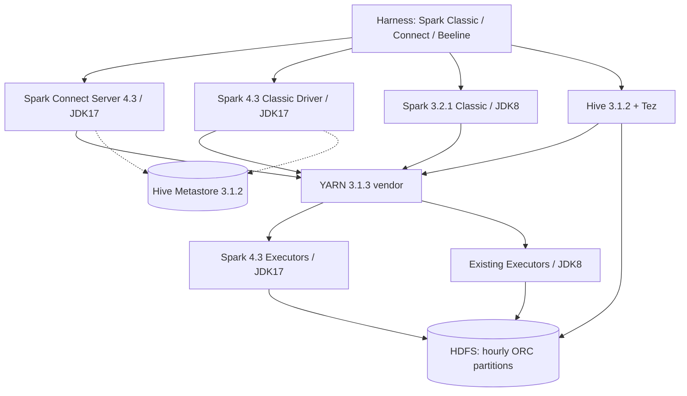

# Методика benchmark: ORC / HDFS / Spark 3.2.1 / Spark 4.3 / Spark Connect / Hive — профиль SM_UKO

> **Редакция:** 10.11.2026. **Статус:** синхронизированная программа испытаний; результатов новых испытаний нет.  
> **Основной источник фактических характеристик:** `анализ_индекса_SM_UKO.docx`, «Анализ индекса CI02001608_CI00982781_SM_UKO», состояние на 21.10.2026, стр. 1–10.  
> **Базовая методика:** `ORC_HDFS_Spark_3.2_4.3_Spark_Connect_Hive_Benchmark.md` (редакция с 52 разделами). В этой редакции вместо абстрактных `field_high`, `field_medium`, `field_low`, `msg`, `event_date` используются поля и запросы индекса SM_UKO. Сохранены классы испытаний ORC, HDFS, Spark, Connect, Hive, concurrency и SLA.  
> **Строгое разграничение:** «Факт отчёта» — сведения из анализа; «Параметр испытания» — предлагаемая настройка; «Не подтверждено» — нуждается в исследовании на кластере. Не использовать синтетические результаты как реальные измерения.

## 1. Цель и гипотезы

Сравнить **одни и те же реальные классы поисковых запросов** по часовому архиву в четырёх вычислительных профилях: `S32` (Spark 3.2.1 Classic), `S43` (Spark 4.3 Classic), `C43` (Spark Connect 4.3, сервер Spark 4.3), `H31` (Hive 3.1.2 / Tez 0.9.1), при *одинаковых ORC-файлах и логических данных*. Отдельно тестировать изменения физического layout ORC, не смешивая их с обновлением движка.

1. **H1 — layout:** какой выигрыш даёт упорядочивание по `session`, ORC Bloom(`session`), min/max, выбор размера stripes/row groups и организация часовых партиций по сравнению с исходным time-ordered ZLIB ORC.
2. **H2 — движок:** что меняется при переходе `S32 → S43` на неизменных файлах и квотах.
3. **H3 — протокол:** какова дополнительная стоимость `C43` относительно `S43`: gRPC, анализ логического плана, Arrow, сессии, передача результата.
4. **H4 — эксплуатация:** очереди `archive-query`, YARN, параллельность, отказоустойчивость; отличить задержку ожидания от времени исполнения.
5. **H5 — семантика:** сохраняются ли строки, типы, сортировка, NULL, поиск в массивах и `LIKE`/`ILIKE` между движками.

**Исходный критерий прежней методики «AVG ≤ 3 с» сохранить только как *исследовательский целевой KPI*, не как установленное SLA для всех исторических запросов SM_UKO.** В отчёте длительность промышленных запросов составляет часы и включает очередь; требуемое SLA для новой системы необходимо согласовать отдельно. Стр. 8 указывает, что отмены происходили в первые 2 часа; это наблюдение, а не утверждённое SLA.

## 2. Фактический профиль индекса и хранения

### 2.1. Размеры и партиционирование — фиксировать без изменения

| Характеристика | Значение по анализу | Как воспроизводить |
|---|---:|---|
| Индекс | `CI02001608_CI00982781_SM_UKO` | логическое имя набора / отдельная тестовая БД |
| Диапазон | 11.03.2024–21.10.2026 (~31 месяц) | сравнение исторической и новой эпох |
| Сжатый объём, **одна копия** | **145,0 ТБ** (131,9 ТиБ) | не путать с HDFS replicated size |
| С репликацией ×3 | **435 ТБ** (395,7 ТиБ) | учёт реального физического объёма |
| Оценка без сжатия | ~3,9 ПБ (коэффициент ~27) | исходная оценка, не гарантия для новых кодеков |
| Партиции | **22 845**, по часу | `key=yyyy-MM-dd--HH` |
| ORC-файлы | **157 917**, среднее ~7/партицию, максимум 77 | профиль распределения file count |
| HDFS block / replication | **256 МБ / 3** | оригинальный профиль; на НТ коэффициент репликации может отличаться |
| 10-й / 50-й / 90-й / 99-й перцентиль партиции | 0,93 / 5,34 / 14,8 / 18,8 ГБ | воспроизводить неоднородность, не одинаковые часы |
| Максимальная партиция | **24,1 ГБ** | крайний сценарий |
| Мелкие партиции | 601 меньше 100 МБ; одна пустая | отдельные negative/boundary тесты |
| Дневная вариация | пик 08–11; минимум 22–00; день/ночь 5–8× | профиль генератора по часам |

**Медианная партиция `key=2026-06-28--09`:** 19 159 061 строк, 5,34 ГБ сжатых (~280 байт на строку); ~144 ГБ до сжатия; ZLIB ~27×; 7 ORC-файлов (шесть по ~0,89 ГБ и хвост ~31 МБ); каждый основной файл содержит около 10 минут событий и ~3,2 млн строк; примерно 100 stripes на файл, ~31 тыс. строк и ~8,4 МБ/stripe. **Физический порядок исходных строк — по времени.** Эти характеристики — базовый эталон `ORC-BASE`, а не «идеальный ORC».

| Эпоха | Сутки, медиана (диапазон), макс. | Средняя часовая партиция | Средний ORC-файл | 5 суток |
|---|---|---:|---:|---:|
| 04.2024–06.2025 (старая) | **233 ГБ** (171–267), макс. 321 | **9,7 ГБ** | 1,27 ГБ | **~1,17 ТБ** |
| 07.2025–10.2026 (новая) | **99 ГБ** (79–114), макс. 133 | **4,1 ГБ** | 0,60 ГБ | **~0,49 ТБ** |

Профили старой и новой эпох **нельзя усреднять**. Типовой поиск в журнале запросов направлен в старую эпоху (глубина медиана 545 суток). Для full-window тестов фиксировать эпоху и соответствующие объёмы.

### 2.2. Схема записи (исходные имена, без выдуманной DDL)

| Поле | Логический тип из анализа | Кардинальность / свойства в медианном часу |
|---|---|---|
| `id` | string | UUID длиной 36, уникален |
| `archiveInternalId` | string | UUID длиной 36, уникален |
| `createdAt` | timestamp | ~3,4 млн; фактически совпадает с `__time` |
| `__time` | timestamp | ~3,4 млн; `__time = createdAt` |
| `archiveInsertTime` | timestamp | ~3,4 млн; отставание от события 0–2 секунды |
| `session` | string | длина 64, ~6,6 млн; типично 3 события, до 1 399 |
| `userLogin` | string nullable | до 16, ~4,85 млн; 69% строк — цифровые логины, у FIND общий технический; у MONITORING пусто |
| `userNode` | string | IPv4, до 15, ~1,75 млн |
| `name` | string | **9 типов событий** |
| `module` | string | **1**, всегда `CI00982781_SM_UKO` |
| `sourceSystem` | string | **1**, всегда `CI02001608` |
| `metamodelHash`, `metamodelVersion` | string | **2 варианта**, ~85,6% / ~14,4% |
| `userName` | string nullable | пустая строка / NULL у MONITORING |
| `nodeId` | string | ~1 181; заполнен для MONITORING |
| `requestId` | nullable | **всегда NULL** |
| `tags` | array | ~1 257 комбинаций; 3 элемента: `audit.CImodule`, `audit.namespace`, `audit.pod` |
| `paramName` | array | имена параметров, 17–40 у обычных событий, в среднем ~31; **в источнике несоответствие: 50 имён в таблице 2.1 и 53 в 2.2** |
| `paramValue` | array | пары по индексам с `paramName`; ~80 млн разных значений в медианном часу; суммарно медиана ~400, максимум ~800 символов |
| `paramOldValue` | array | все элементы NULL, позиционно связан с `paramName` |
| `key` | **partition column**, string | `yyyy-MM-dd--HH`, партиционирование **по часу**, не по `event_date` |

**Типы элементов массивов, точные Spark DDL, nullability, timezone и физическое представление `tags` документ не раскрывает.** Для эталонного запуска экспортировать `DESCRIBE FORMATTED`, `SHOW CREATE TABLE` и ORC schema; синтетический генератор должен поддерживать фактический тип `tags` (не навязывать `array<string>`, пока он не подтверждён). `key` — колонка/метаданные партиционирования, её наличие в самом ORC надо проверить. Не заменять `paramName/paramValue` на JSON, MAP или плоские поля в тесте `ORC-BASE`.

**Состав параметров:** в документе фигурируют 17 служебных `ufs.*`, `ufs.auditContextUUID` (уникален в событии), `EPK_ID` (62%, ~4,87 млн, длина 19, позиция 7–9 в массиве), `SESSION_ID` (62%, ~5,78 млн), `OPERATION_UID` (62%, ~5,93 млн), `CARD_NUMBER` (62%, ~4,82 млн), `IP_ADDRESS` (62%, ~1,73 млн), `PERSON_DOCUMENT_NUMBER` (62,5%, ~1,23 млн), `DEVICE_ID` (60,5%, ~5,29 млн), `DEVICE_INFO` (61%, 6 840), `USER_APP_VERSION` (60,4%, 146), `AUTH_TOKEN` (35,7%, ~7,08 млн), `TB_CODE`/`OSB_CODE`/`VSP_CODE` (~30,5–31%). Доли относятся к исходному анализу, **не считать независимыми** при генерации событий. AUTH_TOKEN длиной до 514 символов, DEVICE_INFO — до 436; 0,08% значений длиннее 100 символов. Для тестов использовать только синтетические токены/идентификаторы без реальных секретов и ПДн.

### 2.3. Типы событий — воспроизводить именно этот состав

| `name` | Строк в медианном часу | Доля | `EPK_ID` |
|---|---:|---:|---|
| `SYSTEM_EVENTS_CREATE_SESSION_WITH_CONFIGURATION_RESPONSE` | 6 037 221 | 31,5% | нет |
| `SYSTEM_EVENTS_FIND` | 5 943 387 | 31,0% | да |
| `SYSTEM_EVENTS_LOGON` | 5 943 317 | 31,0% | да |
| `SYSTEM_EVENTS_CREATE_SESSION_RESPONSE` | 811 676 | 4,2% | нет |
| `SYSTEM_EVENTS_GET_EXTENDED_PERMISSIONS_MOBILE_RESPONSE` | 371 027 | 1,9% | нет |
| `SYSTEM_EVENTS_FORCE_MS_NOTIFICATION_RESPONSE` | 27 659 | 0,14% | нет |
| `MONITORING_IP_UFS_SESSION_REGISTRY_CHANGE_IP` | 22 807 | 0,12% | нет |
| `SYSTEM_EVENTS_SEND_OPERATION_DATA_SBERKIDS_GUEST` | 1 573 | 0,008% | нет |
| `SYSTEM_EVENTS_GET_CONFIGURATION_WEBVIEW_RESPONSE` | 394 | 0,002% | нет |
| **Итого** | **19 159 061** | **100% (округлено)** | |

**Корреляция обязательна:** один вход создаёт связанные `FIND` → `LOGON` → `CREATE_SESSION_WITH_CONFIGURATION_RESPONSE` с общей `session`, временным интервалом в секунды; `EPK_ID` есть только в FIND и LOGON и одинаков у них. Типичная session даёт 3–4 строки, экстремум 1 399. `EPK_ID` в пределах часа обычно 2 строки (до 72), за несколько суток — единицы/десятки. **Нельзя** независимо рандомизировать session/EPK_ID/тип событий: такой dataset не проверит реальные запросы.

### 2.4. Объём JSON не равен схеме хранения

Одна полная строка в JSON оценивается ~1,9 КБ (обычно 1,7–2,2 КБ; максимум 2,5 КБ); это оценка сериализации, а не отдельное поле `msg` длиной 1000. Не добавлять `msg`, `field_high`, `field_medium`, `field_low` из прежней общей методики.

## 3. Ограничения тестового стенда и план размещения данных

| Параметр | Факт отчёта |
|---|---:|
| YARN: всего / свободно vCores | 84 / **81** |
| YARN: всего / свободно RAM | 270 / **241 ГБ** |
| HDFS: свободное место под тесты | В §4.1 указано **3 ТБ с учётом реплик**; в §4.3 — **«около 2 ТБ места»** |
| Желаемая репликация НТ | **2**, предложена в анализе |

**Противоречие 3 ТБ / ~2 ТБ:** прежде чем проектировать масштаб данных, измерить `hdfs dfs -df -h` и квоты тестового каталога; проверить, означает ли «2 ТБ» физическое или логическое свободное место. Не считать 3 ТБ объёмом полезных данных. Учитывать место для **входного dataset, перестроенных вариантов ORC, временных shuffle/output, checksum, реплик**, а также запасы безопасности.

**Расчёт вместимости (пример, не подтверждённая квота):** при физическом бюджете 2 ТБ и `dfs.replication=2` без резерва можно разместить не более ~1 ТБ *логически сжатых* ORC; пять суток старой эпохи ~1,17 ТБ потребуют ~2,34 ТБ физически ещё без альтернативных layout и выходов. Следовательно, одновременное хранение `ORC-BASE + ORC-BLOOM + ORC-SORTED` для типичного 120-часового исторического окна на таком стенде **невозможно**. При бюджете 3 ТБ это также требует строгого расчёта и поочерёдной замены layout.

**Стратегия данных:**

| Профиль | Объём/окно | Содержание и цель | Репликация |
|---|---|---|---|
| `D-HOUR` | **1 час**, полный масштаб: медианная 5,34 ГБ; отдельно старая ~9,7 ГБ | микробенчмарк reader/ORC/index/codec | 2 на НТ |
| `D-DAY` | **24 часа**, старая эпоха ~233 ГБ | реальная суточная неоднородность, 24 партиции | 2 |
| `D-5D-FULL` | **120 часов**, старая эпоха **~1,17 ТБ** | реальный массовый запрос; **условно**, только если подтверждена ёмкость / внешнее read-only хранилище | согласно хранилищу |
| `D-5D-SCALED` | 120 часов, **сокращённый объём с коэффициентом масштаба `s`** | проверить partition fan-out и Spark Connect; не выдавать за full-scan performance | 2 |
| `D-NEW` | 1–24 часа новой эпохи, ~4,1 ГБ/час и ~99 ГБ/сутки | контраст эпохи | 2 |
| `D-EDGE` | пустая, <100 МБ, max 24,1 ГБ, хвостовой ORC | границы, small files | 2 |

Для `D-5D-SCALED` сохранять 120 часовых ключей, профиль по часам/событиям/кардинальностям **в масштабе**, корреляции и query selectivity. При уменьшении количества строк абсолютная кардинальность уникальных UUID/сессий также изменится: сообщать `s`, фактические NDV и hit count. Ни один уменьшенный dataset не должен называться «полная копия 120 часов». **SLA полного 5-дневного запроса нельзя подтверждать масштабированной выборкой.**

Варианты ORC сохранять поочерёдно (один активный layout + проверенный baseline/метаданные) или на отдельном read-only storage. Удалять только тестовые каталоги по утверждённому списку; никогда не использовать production-path для записи.

## 4. Воспроизводимость и генератор

1. **Приоритет №1 — обезличенный снимок реальных ORC** с сохранением распределений и типов; требуется согласование доступа и обезличивания.
2. Если это невозможно — **детерминированный синтетический генератор**, исходные характеристики из §§2.1–2.3; seed фиксируется; персональные данные, действующие `AUTH_TOKEN`, номера документов/карт **не копировать**.
3. Генератор управляется `dataset.yaml` (пример параметров, не контракт исходного ПО):

```yaml
profile: SM_UKO
reference_hour: '2026-06-28--09'
partition_column: key
partition_format: yyyy-MM-dd--HH
partition_period: 1h
hdfs_block_size_mib: 256
benchmark_replication: 2
source_replication: 3
reference_rows_per_median_hour: 19159061
reference_compressed_gib_per_hour: 5.34  # в анализе обозначено ГБ; единицы проверить
reference_orc_files_per_median_hour: 7
reference_tail_file_mb: 31
reference_file_order: createdAt
reference_stripe_avg_mb: 8.4
reference_stripe_avg_rows: 31000
reference_codec: ZLIB
session_ndv_per_median_hour: 6600000
epk_id_ndv_per_median_hour: 4870000
user_login_ndv_per_median_hour: 4850000
user_node_ndv_per_median_hour: 1750000
param_value_ndv_per_median_hour: 80000000
session_typical_event_count: 3
session_max_event_count: 1399
epochs:
  old: {daily_median_gb: 233, hourly_avg_gb: 9.7}
  new: {daily_median_gb: 99, hourly_avg_gb: 4.1}
reference_session_query_hours: 120
scale_factor: 1.0   # обязательно фиксировать, не использовать 1.0 для уменьшенной копии
seed: 20261021
```

**Оговорка:** числа «ГБ», «МБ» в отчёте не везде однозначно различают десятичные и двоичные единицы; перед прямым byte-to-byte сопоставлением сверить с HDFS (`-du -s`) и ORC footer. Генератор не должен молча трактовать 5,34 ГБ как 5,34 GiB.

### 4.1. Генерация событий и зависимостей

- Генерировать профиль `name` из таблицы §2.3, затем формировать связанные тройки событий; оставшиеся события — по соответствующим долям.
- `session`: 64-символьная hex-строка, много уникальных значений, реальное распределение длин «цепочек», часть сессий с 1–4 событиями и редкий тяжёлый хвост до 1 399.
- `EPK_ID`: **19 цифр**, позиция 7–9 в `paramName`; включать только FIND/LOGON, общий EPK_ID у связанных двух событий. Поиск значения выполняется из параллельных массивов, не из отдельного столбца.
- Удерживать пропорции совпадений по `name`, `userLogin`, `userNode`, `module`, `metamodelHash` и `metamodelVersion`; исключения для MONITORING.
- Сформировать ~53 различных имён параметров **после сверки противоречия 50/53**; синтезировать 17 `ufs.*`, `EPK_ID`, прочие по долям, длинам и обусловленной корреляции.
- Для строк с отсутствующим параметром — `paramName` не содержит его, **не** заменять отсутствующий ключ пустой строкой или NULL в присутствующем ключе без соответствующего эталона.
- Значения отсутствующих имен `STAFF_LOGIN`, `STAFF_NUMBER`, `CLIENT_ID`, `CLIENT_TB`, `CLIENT_IP_ADDRESS`, `EMPLOYEE_IP_ADDRESS`, `ARM_IP` **не создавать** (тесты ожидают 0 строк).
- Историческая плотность по часам, различие эпох и физическая сортировка по `createdAt` важнее искусственно одинаковых ORC-файлов.

### 4.2. Аудит датасета перед каждым benchmark

Минимальный файл `dataset_validation.json`: actual partitions, logical bytes, replicated bytes, ORC files, small-file tail count, size percentile, NDV по `session`, `EPK_ID`, `userLogin`, `userNode`, event distributions, типы массивов, `EPK_ID` fill rate, позиции 7–9, NULL rate, количество строк на session (P50/P90/max), equality `createdAt = __time`, старые/новые часы, порядок timestamp внутри файлов. Сравнивать с исходной статистикой и публиковать отклонения.

Контрольная SQL-подборка (идентичность схемы подтверждается до запуска):

```sql
SELECT key, count(*) AS rows_in_hour, count(DISTINCT session) AS sessions,
       count(DISTINCT userNode) AS nodes
FROM sm_uko_bench.events
WHERE key = '2026-06-28--09'
GROUP BY key;

SELECT name, count(*) AS cnt
FROM sm_uko_bench.events
WHERE key = '2026-06-28--09'
GROUP BY name;

SELECT count(*) AS inconsistent_time
FROM sm_uko_bench.events
WHERE key = '2026-06-28--09' AND NOT (createdAt <=> `__time`);
```

`COUNT(DISTINCT ...)` на полном часу может быть тяжёлым; для генераторной валидации использовать заранее собранный независимый manifest либо точные проверки на выборках, отдельно отмечая использование приближённых NDV.

## 5. Производственный workload — единственный источник весов benchmark

В отчёте за 01.07–30.09.2026: **1 107 запросов**, **34 пользователя**, **41 шаблон** (без значений), **874 запроса от одной учётной записи**, две зоны `PRIMARY_SDP` 526 и `SECONDARY_SDP` 581. Тип запросов: `SELECT * … ORDER BY "__time" DESC` **без LIMIT**. Время (`search_from`, `search_to`) передаётся сервисом **вне SQL**, по нему выбираются часовые партиции.

| ID | Группа | Количество | Доля | Окно | Результат по отчёту | Приоритет |
|---|---|---:|---:|---|---|---|
| `W01` | `session`, `ILIKE` | **875** | **79,0%** | ровно **120 ч**, 120 партиций | ~4 строки; ~8 при OR двух session | P0 |
| `W02` | `EPK_ID`, `name` и массивы | **107** | **9,7%** | 1–31 сут | 0–25 | P0 |
| `W03` | полнотекстовый OR по **16 колонкам** | **56** | **5,1%** | 0,4–17 сут | 0–42, исключение ~260 тыс. | P0 по resource cost |
| `W04` | `userNode` / `userLogin` | **23** | **2,1%** | 1–5 сут | 8–73 | P1 |
| `W05` | `module + name + файл EPK_ID` | **20** | **1,8%** | 15 сут; два по 128 сут | 350 тыс.–6,5 млн | P0 на сортировку/выдачу |
| `W06` | несуществующие параметры | **13** | **1,2%** | 0,1 ч–31 сут | **0** | P0 как negative test |
| `W07` | другие параметры (`OPERATION_UID`, `DEVICE_ID`) | **6** | **0,5%** | 1–4 сут | 0–3 | P2 |
| `W08` | без условий | **7** | **0,6%** | 9 сут | ~2,3 млн | P1 на materialization |
| | **ИТОГО** | **1107** | **100%** | | | |

По совокупному времени из отчёта `W01` — 54%, `W03` — 23%, `W04` — 9,5%, `W06` — 5%; это **время с очередью**, не чистая стоимость SQL. `W03+W04` — ~7% количества, но ~33% времени, исключать их из микса нельзя.

### 5.1. Параметризация и перенос семантики SQL

- Примеры `:v`, `:hour_from`, `:hour_to`, `:epk_ids_view` ниже — **переменные тестового harness**, а не исполняемый синтаксис Spark SQL. Harness должен применять безопасную параметризацию или гарантированно экранировать литералы.
- `key >= :hour_from AND key < :hour_to` — **реализация** внешнего выбора часовых партиций в SQL Spark/Hive, эквивалентная только при подтверждении контракта `search_from/search_to`, timezone, границ, формата ключа. Сначала сверить часы; не подменять 120 часов фильтром по `createdAt`, который не обеспечивает гарантированный partition pruning.
- Продовые запросы используют `ILIKE`/`LIKE`; Spark 3.2.1 может требовать перенос `ILIKE` через `LOWER(x) LIKE LOWER(pattern)`; **фиксировать это как семантический адаптер**, а не считать идентичным по pushdown/плану. Для equality-оптимизации делать отдельный тест.
- В массиве `paramName` позиция вычисляется `array_position` (1-based); для 0-based `paramValue[index]` нужен индекс `pos-1`. Для переносимого варианта Spark SQL безопаснее использовать `element_at(paramValue, pos)` (1-based), **но только если `pos>0`**, иначе `element_at(..., 0)` ошибочен. `CASE WHEN` с `pos>0` и безопасной проверкой длины массива обязателен. При тестировании Hive формулу адаптировать к Hive API и проверить с отсутствующими параметрами.
- Все тесты **сначала** сравнивают эталон `SELECT * + ORDER BY __time DESC + отсутствие LIMIT`; только затем идут отдельные контролируемые оптимизации `SELECT нужные поля`, `LIMIT`, `=` и иные rewrite. Результаты двух классов запросов нельзя смешивать.

## 6. SQL suite на основе реальных шаблонов

Во всех запросах `sm_uko_bench.events` — тестовая таблица, `key` — часовой partition key. `:from`/`:to` должны задавать ровно выбранные часы. **Для Spark 3.2 / 4.3 / Hive/Tez проверять через EXPLAIN, что partition pruning фактически сработал.**

### W01 — поиск по session, 120 часовых партиций, 79% запросов

**Базовый (семантика исходного запроса, Spark-перенос с `LOWER`):**

```sql
SELECT *
FROM sm_uko_bench.events
WHERE key >= :from AND key < :to
  AND lower(CAST(session AS STRING)) LIKE lower(:session_pattern)
ORDER BY `__time` DESC;
```

- `:to - :from = 120 ч`. Сравнить `D-5D-FULL` старой эпохи и `D-5D-SCALED`, отдельный час и новую эпоху.
- `:session_pattern` для parity может быть точным 64-hex значением без `%` или LIKE-образцом, **фактическую форму паттерна запросов в анализе не раскрыли**. Перед формированием окончательной смеси извлечь её из обезличенных исходных шаблонов/журнала.
- Контроль: обычно 3–4 найденные строки, экстремальный session до 1 399; для `OR` по двум session обычно ~8.
- `W01-EQ`: `session = :session` вместо `LOWER(...) LIKE ...`, при строгом подтверждении эквивалентности целевых значений. `W01-BF`: тот же `W01-EQ` на ORC Bloom(`session`). **Только эти ветки можно трактовать как проверку индексного ускорения exact match.**
- Отдельно сравнить Bloom без сортировки, Bloom + сортировку по session, исходную сортировку по времени и rewrite с поиском без `CAST`.

### W02 — поиск по EPK_ID из параллельных массивов, 9,7%

Ниже приведён SQL-шаблон для Spark 3.2/4.3. В нём вычисление позиции повторяется для переносимости; после проверки эквивалентности разрешён CTE с явным перечислением колонок.

```sql
SELECT *
FROM sm_uko_bench.events
WHERE key >= :from AND key < :to
  AND name = :event_name
  AND CASE
        WHEN array_position(paramName, 'EPK_ID') > 0
         AND array_position(paramName, 'EPK_ID') <= size(paramValue)
        THEN lower(element_at(paramValue, array_position(paramName, 'EPK_ID')))
             LIKE lower(:epk_pattern)
        ELSE false
      END
ORDER BY `__time` DESC;
```

Профили: FIND и LOGON, `EPK_ID` найден / отсутствует, день / 5 суток / 31 сутки (последний только если хватает данных). Контроль числа строк 0–25; `paramName/paramValue` — реальные массивы, а не дополнительное столбцовое поле `epk_id`. **Эталонный массивный доступ** из отчёта: `paramValue[ARRAY_POSITION(paramName,'EPK_ID')-1]` (0-based). При отличии результата считать тест G1 не пройденным.

### W03 — полнотекстовый поиск по 16 полям через OR, 5,1%

Исходный отчёт раскрывает **только часть** полей полного выражения: `paramName`, `paramValue`, `tags`, `userNode` и многоточие. **Полный перечень 16 столбцов не предоставлен.** Чтобы не подменять workload, обязательный шаг подготовки — извлечь полный оригинальный шаблон (без значений) из журнала/исходного кода; до этого **тест `W03-PROD` заблокирован**, а `W03-SUBSET` может использоваться только как нерепрезентативный smoke-test.

```sql
-- W03-SUBSET: НЕ production-parity; лишь демонстрация структуры.
SELECT *
FROM sm_uko_bench.events
WHERE key >= :from AND key < :to
  AND (
       CAST(paramName AS STRING) LIKE :pattern
    OR CAST(paramValue AS STRING) LIKE :pattern
    OR CAST(tags AS STRING) LIKE :pattern
    OR CAST(userNode AS STRING) LIKE :pattern
  )
ORDER BY `__time` DESC;
```

Строковое представление массивов при `CAST(array AS STRING)` **может различаться** между Spark и Hive. Сопоставить результат с эталонным SQL сервиса (не замещать автоматически `concat_ws`, `array_join`). В наборе проверок: типично 0–42 строк; один тяжёлый шаблон ~260 тыс.; периоды 0,4–17 суток.

### W04 — поиск по userNode / userLogin, 2,1%

```sql
SELECT *
FROM sm_uko_bench.events
WHERE key >= :from AND key < :to
  AND name = :event_name
  AND CAST(userNode AS STRING) LIKE :node_pattern
ORDER BY `__time` DESC;
```

Аналогичная ветка по `userLogin` с исходным шаблоном фильтра. Нагрузка 1–5 суток, ожидаемые выборки порядка 8–73 строк; точные значения зависят от генератора.

### W05 — `module + name + файл условий EPK_ID`, 1,8%

Файл условий содержит ~216 КБ / ~10,8 тыс. `EPK_ID`. Сам `module` — константа и не селективен. Продуктивный контракт файла условий и способ применения **не раскрыты**; тестовый harness должен подготовить view из синтетического списка `EPK_ID` и записать фактическую семантику (join/`IN`/subquery). Ниже **возможная** эквивалентная физическая реализация, которую нужно сравнить с эталоном:

```sql
SELECT e.*
FROM sm_uko_bench.events e
JOIN sm_uko_bench.epk_filter f
  ON CASE WHEN array_position(e.paramName, 'EPK_ID') > 0
          AND array_position(e.paramName, 'EPK_ID') <= size(e.paramValue)
          THEN element_at(e.paramValue, array_position(e.paramName, 'EPK_ID'))
          ELSE NULL END = f.epk_id
WHERE e.key >= :from AND e.key < :to
  AND e.module = 'CI00982781_SM_UKO'
  AND e.name = :event_name
ORDER BY e.`__time` DESC;
```

**Важно:** в SQL выше мультипликативность JOIN зависит от дубликатов в `epk_filter`; в harness обеспечить уникальные значения либо сравнить с оригинальной `IN`-семантикой. Периоды 15 суток (обычный) и 128 суток (2 запроса), результаты 350 тыс.–6,5 млн строк. Не использовать клиентский `collect()` для вывода полного результата — тест materialization через запись/контрольный хеш, а перенос Arrow как *отдельный* эксперимент.

### W06 — несуществующие имена параметров, 1,2%

```sql
SELECT *
FROM sm_uko_bench.events
WHERE key >= :from AND key < :to
  AND array_position(paramName, 'STAFF_LOGIN') > 0
ORDER BY `__time` DESC;
```

Прогнать отдельно по всем **7** отсутствующим именам: `STAFF_LOGIN`, `STAFF_NUMBER`, `CLIENT_ID`, `CLIENT_TB`, `CLIENT_IP_ADDRESS`, `EMPLOYEE_IP_ADDRESS`, `ARM_IP`. **Ожидаемый ответ: 0**. Контрольная архитектурная оптимизация — dictionary-check имён **до запуска Spark**, но это не native ORC indexing; время precheck учитывать в end-to-end, а результаты `precheck` и `no-precheck` не смешивать.

### W07 — OPERATION_UID / DEVICE_ID и прочие параметры, 0,5%

```sql
SELECT *
FROM sm_uko_bench.events
WHERE key >= :from AND key < :to
  AND CASE WHEN array_position(paramName, :param_name) > 0
            AND array_position(paramName, :param_name) <= size(paramValue)
           THEN element_at(paramValue, array_position(paramName, :param_name))
           ELSE NULL END = :param_value
ORDER BY `__time` DESC;
```

Диапазон 1–4 суток, результат 0–3 строки. Подмену исходного `ILIKE` точным `=` разрешать только как отдельный `REWRITE` тест при доказанной эквивалентности.

### W08 — без фильтров, 0,6%

```sql
SELECT *
FROM sm_uko_bench.events
WHERE key >= :from AND key < :to
ORDER BY `__time` DESC;
```

9 суток, ~2,3 млн строк результата по отчёту; реальный объём `SELECT *` — существенная часть workload. Отдельно: `ORDER BY`/`LIMIT`/`count(*)` не равнозначны этому запросу и не должны подменять baseline.

### T01–T05 — производные диагностические запросы (не заменяют W01–W08)

- `T01`: `SELECT session, count(*)` за 1 час (распределение цепочек).
- `T02`: `SELECT name, count(*)` за 1/24 часа (9 категорий).
- `T03`: `SELECT userNode, count(*)` за час (cardinality/skew).
- `T04`: `SELECT key, count(*)` за 24/120 часов (partition pruning и skew).
- `T05`: `JOIN` с маленьким synthetic dictionary для AQE/DPP/CBO (созданный тест, **не наблюдавшийся** в 41 шаблоне). Применять только для оценки оптимизатора, не учитывать в production mix.

## 7. Корректность результатов и измерительные режимы

**Для каждого `Wxx`:** (1) один и тот же список партиций, (2) один и тот же литерал/набор значений, (3) одинаковый порядок обработки NULL и коллаций, (4) полное число строк / checksum, (5) режим с `ORDER BY` и исходным `SELECT *`, (6) отдельная оптимизированная ветка. Для `W05/W08` сравнение результатов выполнять через серверный sink с checksum/partitioned output; запись учитывается в latency, если она была в оригинальном процессе archive-query.

| Время / метрика | Значение | Где брать |
|---|---|---|
| `T_total_service` | создание → финальный статус | archive-query/Postgres |
| `T_service_queue` | NEW → submit | сервисные события/дополнительная инструментализация |
| `T_yarn_wait_driver` | submit → Driver startup | YARN events |
| `T_wait_executors` | Driver startup → первый Executor | Spark event log |
| `T_spark` | первый исполняемый stage → завершение Spark job | Spark event logs/UI |
| `T_finalize` | Spark завершён → final_status | сервисные события |
| `T_connect_client` | клиентский вызов → полностью полученный результат | клиентский monotonic timer |
| `T_first_result` | до первого Arrow batch | client/gRPC tracing |
| `T_arrow_transfer` | получение всего набора batches | клиент + gRPC telemetry |
| `HDFS read bytes` | физический объём чтения | FS stats/YARN metrics, указать источник |
| `ORC skipped stripes/row groups` | эффективность index pruning | reader instrumentation, если доступно; не выдумывать метрику |
| `partitions/files selected`, `tasks`, `CPU`, `GC`, `shuffle`, `spill` | профиль исполнения | Spark UI/event log и EXPLAIN |

**Не сравнивать промышленную статистику FINISHED/DELETED как «время Spark».** В анализе median FINISHED ~2,2 ч, среднее `W01` ~2,8 ч; обе величины включают очередь. Для `DELETED` время часто включает позднее удаление результатов; исключать из latency reference. Для FAILED есть предположение о неполучении ресурсов (14 повторов), это не установленный факт исполнения.

`scan_ratio = physical_read_bytes / logical_compressed_bytes_of_selected_partitions` — только диагностический показатель, а не доля проанализированных строк; определить, включены ли кешированные чтения. `improvement = baseline_latency / candidate_latency`; `connect_overhead = (C43_end_to_end - S43_end_to_end) / S43_end_to_end` только при **одинаковой материализации результата, одинаковом клиентском пути (где возможно) и сопоставимых вычислительных планах**. При нулевой/очень малой S43-латентности дополнительно публиковать абсолютную разницу в миллисекундах.

## 8. Этапы ORC-layout — привязка к W01–W08

Начальная точка — **`ORC-BASE`: ZLIB, временной порядок, 7 файлов в медианном часу (6×0,89 ГБ + хвост 31 МБ), реальные ~100 stripes/file и ~31 тыс. rows/stripe**. «Стандартный stripe size 64 MiB» из общей методики **не соответствует** наблюдаемому фактическому layout (~8,4 МБ/stripe), поэтому это только один из контролируемых вариантов перестройки, а не baseline.

| ID | Фактор / варианты | Ключевые запросы | Важная оговорка |
|---|---|---|---|
| `O00` | Исходные ZLIB ORC, time-order | W01–W08 | точное воспроизведение |
| `O01` | Column pruning: `SELECT *` vs `session`, `__time`/другие поля | W01,W02,W04 | отдельная оптимизация, не исходный SQL |
| `O02` | Predicate pushdown ON/OFF | W01-EQ, W04, W07 | сложный `ARRAY_POSITION` может не pushdown |
| `O03` | Partition pruning 1h vs 24h vs 120h | W01,W02,W03,W08 | ключ `key`, не дата отдельной колонкой |
| `O04` | Sorting: `createdAt`, `session`, `userNode`, `userLogin` | W01-EQ,W04 | менять физический порядок **внутри** часовой партиции, не данные |
| `O05` | Bloom: OFF; `session`; `userNode`; `userLogin`; комбинации | W01-EQ,W04 | Bloom по `EPK_ID` невозможен напрямую на отдельной колонке, которой нет; только отдельный schema-rewrite |
| `O06` | Bloom FPP 0.05 / 0.01 / 0.001 | W01-EQ,W04 | фиксировать поддерживаемую версию ORC writer |
| `O07` | `row.index.stride`: 5k,10k,20k,50k | W01-EQ,W04 | сравнивать с **фактическим** stride исходных ORC footer |
| `O08` | stripe target: фактический ~8,4 МБ, 64/128/256 МиБ | W01–W04,W08 | реальный target vs фактический stripe может различаться |
| `O09` | ZLIB / SNAPPY / ZSTD | W01,W03,W08 | совместимость с Hive 3.1.2 и ORC reader; сравнивать bytes и CPU |
| `O10` | число файлов: исходные ~7/час, compacted, small files | W01,W03,W08 | учитывать хвост 31 МБ, максимальные 77 файлов/час |
| `O11` | HDFS short-circuit OFF/ON | W01–W04 | только если Executors совмещены с DataNode; может требовать изменение кластера |
| `O12` | cold/warm OS/HDFS cache / centralized cache | W01,W03 | HDFS centralized cache необязателен и требует админских разрешений |
| `O13` | **derived index**: материализованный `EPK_ID` отдельной колонкой или вспомогательный lookup | W02,W05 | **не исходная схема**; отдельный продуктовый redesign, считать storage/write overhead |
| `O14` | session Bloom + session-sort + exact equality | W01 | основной кандидат оптимизации 79% нагрузки |
| `O15` | Bucketing по `session` или `EPK_ID` в отдельной производной таблице | W01-EQ,W05 | **не baseline**; требуется перепись таблицы и проверка bucket pruning, стоимость записи |
| `O16` | Materialized view / агрегированные проекции (опционально) | T01–T04 | нет прямой эквивалентности исходным `SELECT *` |

**Факторная методика:** `O00` → менять **один** физический фактор → 3–5 прогревочных + 20–30 измеренных прогонов для небольших тестов, тяжёлые запросы отдельным обоснованным протоколом. Лучшие факторы объединить в `ORC-BEST` и только затем сравнить S32/S43/C43/H31 на **точно тех же байтах ORC**. `O13` и `O14` меняют схему/SQL и не могут выступать прозрачной заменой стандартному `ORC-BASE`.

**ORC-метрики:** physical read bytes, ORC stripes/row groups skipped (если доступно), files opened, time to first row, CPU/decompression, сортировка/Shuffle для `ORDER BY`, время записи, индексные накладные расходы, сжатый размер, cardinality в footer, фактические `stripe.size`, `row.index.stride`, Bloom streams.

## 9. Spark 3.2 / Spark 4.3 Classic — тесты execution

| ID | Вариант | Suite | Что измеряется |
|---|---|---|---|
| `S01` | native ORC vectorized reader ON/OFF | W01,W02,W03,W08 | скорость unpack массивов и широкого `SELECT *` |
| `S02` | Spark SQL ANSI, timezone, array indexing, LIKE / LOWER | W01,W02,W03,W06,W07 | семантическая регрессия |
| `S03` | AQE OFF/ON | W05,W08,T03,T05 | shuffle, sort, skew, joins только там, где они есть |
| `S04` | Dynamic Partition Pruning OFF/ON | **T05**, не W01 | DPP требует соответствующего JOIN-сценария |
| `S05` | CBO stats OFF/ON | T03,T05 | выбор плана; не приписывать эффект обычному `session` scan |
| `S06` | Broadcast Join AUTO/FORCED/OFF | W05 (если join файл),T05 | стоимость JOIN условий EPK_ID |
| `S07` | Whole-stage/codegen / vectorization | W01,W02,W03 | CPU на CAST/LIKE/массивах |
| `S08` | `ORDER BY __time DESC` и альтернативная выдача | W01,W05,W08 | shuffle + глобальная сортировка; изменённая семантика в отдельной ветке |
| `S09` | batches по 20 hour partitions против одного job | W01 | накладные расходы оркестрации, изменения backend-методики |
| `S10` | 1h old/new и полный 120h old | W01 | зависимость throughput от размера эпохи |

Контрольные настройки для S32 и S43 (если поддержаны обеими версиями) задавать явно и фиксировать effective config; не трактовать одинаковое имя опции как гарантию одинакового алгоритма. Снимать `EXPLAIN FORMATTED`, execution plan с adaptive final plan, GC, spill, task locality, ORC vectorized scan details. Двойные пути Hive SerDe/native ORC тестировать раздельно.

## 10. Spark Connect 4.3 — отдельная программа

**Обязательная цепочка:** `S43 Classic` vs `C43 Connect` **на Spark 4.3 server**, одинаковый JDK, ORC files, Executor quota, SQL session properties, параметры запросов и материализация результата. Connect **не** выполняется на серверном Spark 3.2.1; `C43` — серверная версия 4.3, не просто библиотека-клиент.

| ID | Эксперимент | Dataset / запрос | Показатели |
|---|---|---|---|
| `C01` | `SELECT 1`, metadata/schema | без HDFS | gRPC+сессия+анализ/планирование; P50/P95/P99 |
| `C02` | точный поиск session | W01 на D-HOUR и D-DAY | overhead относительно S43; 3–8 строк |
| `C03` | 120-часовой поиск | W01 на D-5D-SCALED, при возможности FULL | throughput, queue, избыточные stage |
| `C04` | получение EPK_ID из массивов | W02 | совместимость array_position/element_at и Arrow |
| `C05` | тяжёлый OR/CAST | W03-PROD после получения 16 полей | server CPU vs protocol overhead |
| `C06` | широкий результат + глобальная сортировка | W05,W08 | Arrow batches, bytes transferred, memory client/driver |
| `C07` | результат 0 / 4 / 8 / 73 / 260k / 2.3m / 6.5m строк | W06,W01,W04,W03,W08,W05 | передача, клиентская память, gRPC limits; большие наборы — опционально при бюджете |
| `C08` | повторное использование сессии vs новая сессия | W01 на D-HOUR | init overhead, состояние сессии |
| `C09` | SQL через Connect vs DataFrame API | W01,W02,W04 | планы/результаты/latency |
| `C10` | 1/5/10/25/50 одновременных клиентов | workload из §5 | throughput, очередь, ошибка, сессии |
| `C11` | disconnect, cancel, deadline, retry | W01,W03,W08 | жизненный цикл операции, orphan tasks |
| `C12` | разделение доступа / аудит | W01,W02 | identity, права HDFS, session/operation IDs |
| `C13` | сетевые задержки, размеры результатов | W01,W05 | time-to-first-batch и end-to-end, не CPU Spark |

**Варианты измерения результата фиксировать отдельно:**

- `M1_engine`: серверное Spark execution без выдачи полного результата (на обеих сторонах одинаковый `COUNT`/server-side sink). Не использовать M1 для оценки времени исходного `SELECT *`.
- `M2_original`: исходный `SELECT * ORDER BY __time DESC`, материализация такого же объёма через одинаковые типы sinks.
- `M3_client_fetch`: передача **всего результата** Spark Connect через Arrow, сравниваемая с реально аналогичным вариантом Classic. `show(20)` и `count()` не эквивалентны M3.
- `M4_first_row`: время до первого батча / строки, отдельно от полного времени выполнения.

**Не сравнивать время, измеренное на клиенте Connect, со Spark event log Classic без учёта различий границ замера.** Надо публиковать обе величины. При тестировании Connect не передавать реальные PII/секреты в сессионные логи.

## 11. Hive/Tez и LLAP

`H31 = Hive 3.1.2 + Tez 0.9.1` на одних ORC с S32/S43. Тесты Hive vectorized execution ON/OFF и CBO ON/OFF; сравнивать W01/W02/W03/W04/W08, а не только выдуманный GROUP BY. Для W02/W07 адаптировать доступ к массиву под синтаксис Hive, **сначала** G1-проверка результата. Проверить `ZSTD` чтение старым Hive перед сравнением компрессии.

`LLAP = null` в текущем окружении. `Hive + LLAP cold/warm`, выделенный размер кеша, кеш-хиты и прочие сценарии прежней методики пометить **OPTIONAL / BLOCKED** до развёртывания; не включать в обязательную итоговую матрицу.

## 12. Схема запуска без обновления Hadoop



Схема логическая, не схема размещения процессов: драйверы, Executors и Hive/Tez имеют разный жизненный цикл. **G0-GATE:** Java17 у Driver/Executors, YARN deployment, HDFS, Metastore, ORC, security, отдельный namespace; вендорская Hadoop 3.1.3 с Spark 4.3 **не подтверждена**. При неуспехе YARN — отдельный Standalone/Kubernetes compute c HDFS, но этот вариант уже нельзя выдавать за чистое сравнение ресурсов с Spark 3.2 на YARN.

## 13. Ресурсные профили и реальная concurrency

**Факт профиля `common` из анализа (прод):**

```properties
spark.executor.instances=4
spark.executor.cores=2
spark.executor.memory=3g
spark.yarn.executor.memoryOverhead=512m
spark.driver.cores=1
spark.driver.memory=2g
spark.memory.fraction=0.8
spark.sql.shuffle.partitions=200
spark.default.parallelism=4
spark.sql.files.maxRecordsPerFile=1000000
spark.yarn.maxAppAttempts=1
spark.eventLog.enabled=true
```

Для Spark 3.2/4.3 выставить **эквивалентный effective config** (синтаксис памяти `spark.yarn.executor.memoryOverhead` проверить для выбранной версии), выключить лишние сервисы, не смешивать отличающиеся dynamic allocation/shuffle services. В `archive-query` шаг выбора новых заданий — каждые 60 секунд, до 15 попыток submit, обработка партиций блоками **20**, baseline 4 Executors × 2 cores. Прямой `spark-submit` проверяет движок; полный benchmark пути сервиса требует запуска **через `archive-query` с профилем `common`** — если интеграция с S43/C43 не реализована, пометить `SERVICE E2E = NOT TESTED`, не приписывать Spark-клиенту время очереди.

**Факт ёмкости НТ:** 81 свободный vCore / 241 ГБ; по CPU при 9 ядрах/запрос — около **9** одновременно полноценных приложений. По памяти оценка ~19 ГБ/приложение → ~12; ограничение — CPU. **80 одновременно незавершённых** в проде означают «включая ожидающие», а не 80 выполняющихся. Для `C43` несколько клиентских сессий могут делить один Driver/Executor pool: считать ресурсы общего сервера, **не умножать** 9 vCores на каждую сессию как в Classic без доказательства.

**Нагрузки:** 1 / 5 / 9 параллельно выполняемых заданий как исследуемая граница ресурсов; 10 / 25 / 50 / 80 **одновременно отправленных/незавершённых** с фиксацией очереди. Для production replay: пики **64 запроса/час**, **11 запросов/мин**, обычные 1–6 одновременных незавершённых; учитывать паттерн burst и пользователя, сформировавшего 79% запросов. Пик 80 — это backlog, не требуемая параллельная ёмкость. Сравнивать отдельно две зоны, поскольку их ресурсная ёмкость не дана.

## 14. Детерминированный workload replay и выбор тестовых значений

1. **Реальный микс `MIX-1107`:** exactly 875×W01 + 107×W02 + 56×W03 + 23×W04 + 20×W05 + 13×W06 + 6×W07 + 7×W08 = 1 107 запросов (исторический срез). Не запускать целиком на FULL-окнах, пока не подтверждены диск и вычислительная ёмкость.
2. **`MIX-1000` (округлённая тестовая пропорция):** W01 790, W02 97, W03 51, W04 21, W05 18, W06 12, W07 5, W08 6; сумма 1000. Использовать **MIX-1107** для точных частот, округлённый вариант только для грубого теста.
3. Для `W01` выбирать из файла `lookup_sessions.csv` реальные **синтетически созданные** session: типовые 3–4 строки; отдельно OR двух значений и экстрим ~1399. Для `W02` — `lookup_epk.csv` со значениями для FIND/LOGON; для `W05` — `epk_filter` на ~10,8 тыс. разных идентификаторов, фиксировать hit ratio.
4. Доли пустого результата и тяжёлые хвосты сохранять по типам: в анализе 112 из 1072 завершённых запросов (~10%) ничего не нашли; **отдельно** проверять zero-result, большие выдачи и несуществующие имена.
5. Период `W01` — 120 **реальных часовых ключей** старой эпохи; другие окна соответствуют §5. Синтетические даты и даты реального архива не смешивать с current wall clock.
6. Файл `query_manifest.csv`: `query_id, group_id, template_id, partition_from, partition_to, expected_rows, result_mode, lookup_value_id, dataset_scale, epoch, seed, file_filter_id`.
7. Файл `run_manifest.json`: git commit, версии Spark/JDK/ORC/Hadoop/Hive, ресурсы, physical layout, HDFS logical/replicated bytes, фактические stats, query plan hash, client/server RTT, cold/warm, timestamps, engine, session_id, YARN application_id.

## 15. Порядок экспериментов и контрольные барьеры

| Гейт | Условие прохождения | При провале |
|---|---|---|
| `G0-ENV` | S43 local + YARN, HDFS read/write test-only, JDK17/ORC/HMS, Connect smoke | отдельно устранить несовместимость; не выполнять бенчмарки |
| `G1-SCHEMA` | точные DDL, массивы, `tags`, `key`; сравнение row count, NDV и correlation | исправить генератор/схему |
| `G2-SQL` | W01–W08 parity, включая отсутствующие параметры, NULL, сортировку | SQL адаптер, запрет PERF сравнения |
| `G3-LAYOUT` | один фактор ORC за раз; `ORC-BASE`, несколько кандидатных layout | исключить несовместимые layout |
| `G4-ENGINE` | S32 vs S43 на **тех же файлах**, CPU/RAM и запросах | записать причины невоспроизводимости |
| `G5-CONNECT` | S43 vs C43; одинаковые server-side результаты и result mode | не рассчитывать Connect overhead |
| `G6-SERVICE` | полный путь archive-query + YARN queue + Spark + finalize инструментирован | измерять только `T_spark`, не заявлять E2E |
| `G7-STRESS` | concurrency, bursts, отмена, recover, HDFS quota | фиксировать capacity breakpoints |
| `G8-DECISION` | результаты воспроизводимы, evidence + GO/NO-GO | не делать вывод о production |

**Порядок:** валидировать `D-HOUR` → `D-DAY` → доступный `D-5D-SCALED` → `D-5D-FULL` только если хватает пространства → ORC-факторы → `ORC-BEST` → четыре профиля исполнения → Connect transfer → concurrency → E2E сервис. Отдельно повторить old/new epoch, `W01` 120h, `W03` тяжёлый 16-field OR, `W05` 10,8k filter, `W06` negative.

### Повторы и статистика

- 3–5 warm-up + 20–30 measured для малых и средних запросов; для очень тяжёлых окон число повторов согласовать и указать доверительные границы/разброс.
- Cold/warm **раздельно**; не заявлять «cold», если нет подтверждённого очищения соответствующего кеша.
- В mixed-workload фиксировать arrival time, queued/active, пользовательские квоты, ошибки/cancellation, rejected, saturation, effective throughput.
- `AVG`, P50/P95/P99, max, `<=3s` success rate (только применимый класс/согласованный KPI), failures, 429/timeout, HDFS read, CPU, network, spill, allocated containers, queue time.
- Повторный запуск не должен «прогревать» другую конфигурацию незаметно: контролировать порядок (рандомизация или чередование блоков).

## 16. Итоговые таблицы

### 16.1. Корректность

| Engine | Dataset | W01 | W02 | W03-PROD | W04 | W05 | W06=0 | W07 | W08 | Notes |
|---|---|---|---|---|---|---|---|---|---|---|
| S32 | D-HOUR / D-DAY | | | BLOCKED до 16 cols | | | | | | |
| S43 | те же ORC | | | BLOCKED до 16 cols | | | | | | |
| C43 | тот же Spark 4.3 | | | BLOCKED до 16 cols | | | | | | |
| H31 | те же ORC | | | BLOCKED до 16 cols | | | | | | |

### 16.2. Производительность

| Run | Engine | Query | Epoch | Hours | Scale | ORC layout | Result mode | AVG | P95 | P99 | HDFS bytes | Queue | Result rows | Status |
|---|---|---|---|---:|---:|---|---|---:|---:|---:|---:|---:|---:|---|
| | S32 | W01 | old | 120 | 1.0 | ORC-BASE | M2 | | | | | | | NOT RUN |
| | S43 | W01 | old | 120 | 1.0 | ORC-BASE | M2 | | | | | | | NOT RUN |
| | C43 | W01 | old | 120 | 1.0 | ORC-BASE | M2 | | | | | | | NOT RUN |

### 16.3. Разложение задержки Connect

| Run | Wxx | Session reuse | Plan/RPC | Spark execution | Arrow fetch | Total client | Rows | Bytes received | RTT | Status |
|---|---|---|---:|---:|---:|---:|---:|---:|---:|---|
| | W01 | yes | | | | | | | | NOT RUN |

### 16.4. Результаты по физическому layout

| Layout | Session Bloom | Sort | Stripe | Stride | Codec | Files/hour | Size bytes | W01-EQ | W01-ILIKE | W02 | W03 | Write cost |
|---|---|---|---|---|---|---:|---:|---:|---:|---:|---:|---:|
| ORC-BASE | исходный, проверить | createdAt | ~8.4 МБ фактически | прочитать footer | ZLIB | ~7 | | | | | | |

## 17. Критерии GO / NO-GO

**GO для Spark 4.3 как отдельного runtime:** подтверждённое окружение без системного апгрейда, идентичность W01–W08 (кроме документированных согласованных отличий), корректное чтение исходного ORC, нет вмешательства в S32/Hive, проверенный runtime/permissions, отсутствие критической регрессии для `W01` и `W03` при равной нагрузке.

**GO для Spark Connect:** дополнительно измерены клиентский overhead на W01 и широких W05/W08, потоковая передача результатов, многосессионность, cancellation, auth/audit и восстановление. Сам факт работы `SELECT 1` не подтверждает readiness.

**NO-GO:** не устранены несовпадения строк по массивам/NULL, неизвестен полный W03 при заявленной «репрезентативности», не подтверждена двусторонняя ORC совместимость, нет ресурсов для полноразмерного W01, YARN/JDK конфликт, подмена engine time сервисной latency, использование 80 queued в качестве 80 executors, представление scaled benchmark как результата production.

**Вывод по возможности SLA:** из представленного анализа **не следует**, что Spark 4.3 или Spark Connect обеспечат 3 секунды на 1,17 ТБ исторического окна; такое утверждение требовало бы отдельного подтверждения. Основная исследуемая гипотеза оптимизации — exact lookup по `session` + ORC Bloom/index при сохранении часового partition pruning; второе направление — предотвращение заведомо пустых запросов до Spark.

## 18. Список открытых вопросов до запуска (без произвольных допущений)

1. Полный `SHOW CREATE TABLE`, точные ORC footer schemas / `tags` item type, timezone `__time`, фактическое расположение `key`.
2. Перечень **всех 16 колонок** W03 и исходная семантика `CAST(array AS STRING)` для обоих движков.
3. В разделе 2.1 документа 50 имён параметров, в 2.2 — 53: согласовать полный словарь с контрактом архива.
4. Реальный синтаксис `ILIKE` patterns (равенство, `%`, `_`) и case folding; `EPK_ID` и `userNode` — фактические выражения.
5. Контракт внешнего выбора `search_from/search_to`, включительность границ, timezone и возможные часы перехода DST.
6. Файл EPK_ID (~216 КБ) — семантика `OR`, `IN`, JOIN и duplicates, формат/кодировка.
7. **Свободное HDFS 3 ТБ или ~2 ТБ?** Физическое или логическое, quotas, актуальная репликация и эксплуатационный резерв.
8. Доступность Java17 runtime на YARN и изолированного Spark Connect Server 4.3, security, Kerberos, Hive Metastore client.
9. Разрешён ли обезличенный sample; иначе согласовать синтетические зависимости и допускаемые расхождения по NDV.
10. Можно ли использовать `archive-query` для S43/C43 или он фиксирован на S32; требуются ли доработки сервиса.
11. Для SLA: **чистое выполнение Spark**, время до первой строки, полная выгрузка или end-to-end из Postgres? Определить разные пороги для W01, W03, W05/W08.

## 19. Источники

**Основной локальный источник:** «Анализ индекса CI02001608_CI00982781_SM_UKO», состояние на 21.10.2026, файл `анализ_индекса_SM_UKO.docx`: стр. 1 (HDFS/ORC/эпохи), 2–4 (схема/кардинальность/типы событий), 5–6 (группы и тексты запросов), 7–8 (очереди/нагрузка), 9–10 (ресурсы НТ/профиль Spark). Отчёт содержит статистику **определённого периода**, не доказательство актуального состояния инфраструктуры на дату этого файла.

**Методическая основа:** ранее разработанный план `ORC_HDFS_Spark_3.2_4.3_Spark_Connect_Hive_Benchmark.md` (обсуждавшийся набор тестов ORC/HDFS/Spark/Hive). Разделы настоящего документа переорганизованы и адаптированы к реальному индексу. Общие ORC-факторы сохранены как отдельные гипотезы, но не выдаются за фактическую структуру данных SM_UKO.

**Официальные спецификации и руководства для проверки API при реализации:**

- [Spark 4.3 Spark Connect overview](https://spark.apache.org/docs/4.3.0/spark-connect-overview.html)
- [Spark 4.3 configuration](https://spark.apache.org/docs/4.3.0/configuration.html)
- [Spark 4.3 on YARN](https://spark.apache.org/docs/4.3.0/running-on-yarn.html)
- [Spark 4.3 SQL migration](https://spark.apache.org/docs/4.3.0/sql-migration-guide.html)
- [Spark 4.3 Hive tables](https://spark.apache.org/docs/4.3.0/sql-data-sources-hive-tables.html)
- [Apache ORC specification](https://orc.apache.org/specification/ORCv1/)
- [Apache ORC Spark configuration](https://orc.apache.org/docs/spark-config.html)
- [Hive ORC Language Manual](https://hive.apache.org/docs/latest/language/languagemanual-orc/)

> **Правило отчётности:** каждое числовое измерение в финальном benchmark должно иметь ссылку на `run_manifest`, соответствующий event log / SQL output / HDFS metadata. Числа из анализа индекса — *референсные свойства source data*, не результаты Spark 4.3 или Spark Connect.
