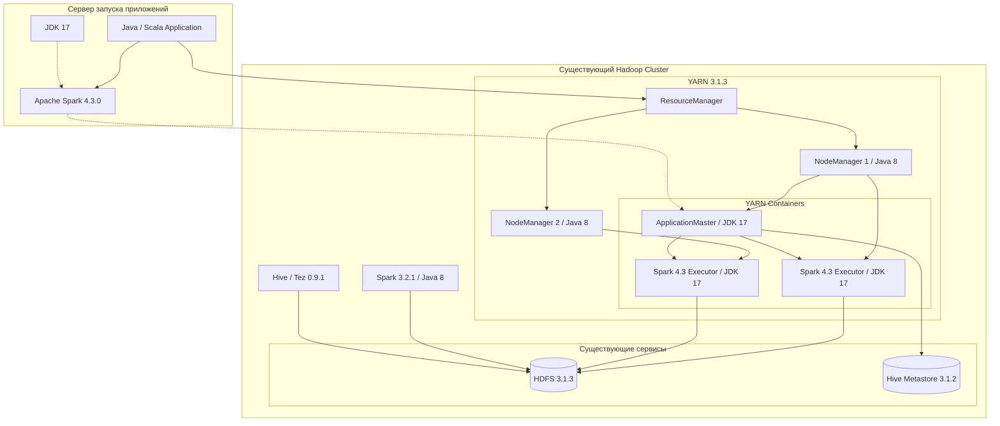
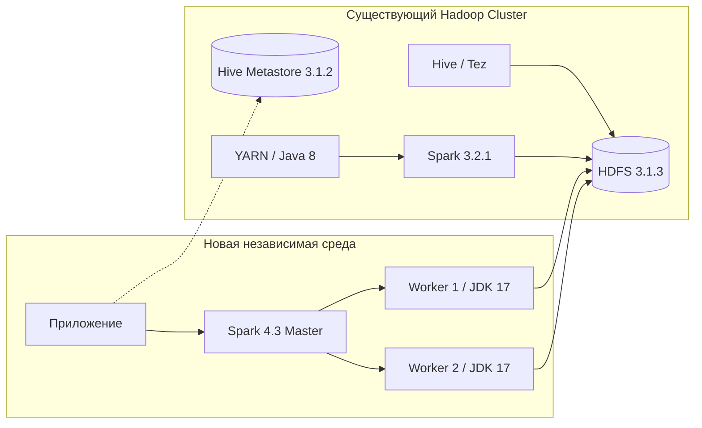

## 1. Архитектурное заключение

Apache Spark 4.3.0 можно попробовать использовать с вашим существующим кластером Hadoop 3.1.3 без обновления Hadoop, Hive, Tez, YARN и системной Java 8.

Для этого необходимо развернуть Spark 4.3.0 как независимый runtime, использующий собственный JDK 17 или 21, собственные библиотеки Spark и существующие сервисы HDFS, YARN и Hive Metastore.

Это предусмотренный документацией Spark подход: для Hadoop старше 3.5.0, работающего на старой Java, Spark допускает отдельный JDK для приложений, в том числе с доставкой JDK через YARN Distributed Cache.

Spark 4.3.0 Documentation

Но есть важное ограничение: официальная документация подтверждает возможность такого способа развёртывания, а не полную совместимость Spark 4.3.0 с вашим конкретным вендорским дистрибутивом `3.5.4.1-1`. Её необходимо проверить экспериментально.

### 1.1. Существующее окружение

|Компонент|Установленная версия|Требуется ли обновление|
|---|---|---|
|Java|1.8.0_292|Нет, для системных процессов|
|Hadoop|3.1.3.3.5.4.1-1|Нет|
|HDFS|В составе Hadoop|Нет|
|YARN|В составе Hadoop|Нет|
|Spark|3.2.1.3.5.4.1-1|Нет, остаётся штатным|
|Hive|3.1.2.3.5.4.1-1|Нет|
|Tez|0.9.1.3.5.4.1-1|Нет|
|Scala|2.12.15|Нет, для старых приложений|
|ORC Spark|1.6.12|Не заменять в штатной поставке|
|ORC Hive|1.5.6|Не заменять|
|ORC Generator|1.6.12|Проверить совместимость формата|
|LLAP|Не установлен|Не требуется|

### 1.2. Что необходимо дополнительно

|Компонент|Версия|Назначение|
|---|---|---|
|Apache Spark|4.3.0|Новый вычислительный runtime|
|JDK|17 или 21|Запуск Spark Driver и Executor|
|Scala|2.13|Компиляция приложений для Spark 4.3|
|Spark 4.3 libraries|Из собственной поставки|Изоляция от Spark 3.2.1|
|Hadoop configuration|Существующая|Подключение к HDFS и YARN|
|Hive Metastore client|Совместимый с Hive 3.1.2|Доступ к каталогу Hive|

Spark 4.3.0 поддерживает Java 17/21/25 и Scala 2.13. Поддержка Scala 2.12 в Spark 4 прекращена.

Spark 4.3.0 Documentation+1

## 2. Варианты использования Spark 4.3 без обновления кластера

Рассмотрим четыре архитектурных варианта.

|Вариант|Где выполняется Spark 4.3|Где используются ресурсы|Изменения кластера|Оценка применимости|
|---|---|---|---|---|
|A. Spark 4.3 on YARN|В YARN-контейнерах|Существующие DataNode/NodeManager|Не требуются при успешном PoC|Основной вариант|
|B. Spark 4.3 Standalone|Отдельные Spark Worker|Выделенные серверы|Не требуются|Хорошая изоляция|
|C. Spark 4.3 on Kubernetes|В Kubernetes Pod|Kubernetes|Не требуются|Подходит при наличии K8s|
|D. Spark 4.3 Local Mode|На отдельном сервере|CPU и RAM этого сервера|Не требуются|Для начального PoC|

Рекомендую начать с варианта A — Spark 4.3.0 on YARN, поскольку он позволяет использовать существующие вычислительные мощности кластера и не требует развёртывания второго менеджера ресурсов.

Варианты B и C полезны как альтернативы, если выяснится, что вендорская сборка Hadoop/YARN несовместима с Spark 4.3.0.

## 3. Вариант A — Spark 4.3.0 поверх существующего YARN

### 3.1. Целевая архитектура



В этой архитектуре:

- Hadoop NameNode, DataNode, ResourceManager и NodeManager продолжают использовать существующую Java 8.
    
- Только процессы Spark 4.3 используют JDK 17.
    
- Spark 3.2.1 остаётся установленным и продолжает обслуживать старые задания.
    
- Новые задания запускаются отдельным `spark-submit` из дистрибутива Spark 4.3.
    
- YARN распределяет ресурсы между приложениями обеих версий.
    

Драйвер Spark запускается в клиентском процессе (`client mode`) либо внутри YARN ApplicationMaster (`cluster mode`). Это стандартные режимы Spark on YARN.

Spark 4.3.0 Documentation

### 3.2. Главная проблема — Java 8 и Java 17

Spark 4.3 не запускается на Java 8. При обычном запуске через существующий YARN контейнер может унаследовать системную Java 8.

Решение — принудительно задать отдельную Java для:

- процесса `spark-submit`;
    
- Spark Driver;
    
- YARN ApplicationMaster;
    
- всех Spark Executors.
    

При этом не требуется менять глобальную переменную `JAVA_HOME` для Hadoop.

Официальная документация содержит два поддерживаемых механизма:

1. Использовать JDK 17, установленный на каждом узле.
    
2. Доставлять архив JDK вместе с приложением через YARN Distributed Cache.
    

Второй механизм наиболее подходит для вашего ограничения «не изменять кластер».

Источник: [Spark 4.3 — Configuring different JDKs for Spark Applications](https://spark.apache.org/docs/4.3.0/running-on-yarn.html?utm_source=chatgpt.com).

## 4. Практическая инструкция: запуск Spark 4.3 на YARN без изменения узлов

Ниже приведена конфигурация для PoC. Пути `/opt/spark43`, `/opt/jdk-17` и `/user/spark43` — примеры, которые необходимо адаптировать. Для работы потребуется выделенный сервер запуска с доступом к ResourceManager, HDFS и YARN, а также права на создание тестового каталога в HDFS.

### Шаг 1. Подготовить независимое окружение Spark 4.3

На выделенном сервере запуска:

```
/opt/
├── jdk-17/
└── spark43/
    ├── bin/
    ├── conf/
    ├── jars/
    └── examples/
```

Скачать Apache Spark 4.3.0 из официального репозитория:

[Apache Spark Downloads](https://spark.apache.org/downloads/?utm_source=chatgpt.com)

Для первого PoC предпочтительна готовая сборка with Hadoop. Она содержит собственные клиентские библиотеки Hadoop и снижает риск прямого смешивания JAR из Spark 4.3 и вендорского Hadoop 3.1.3.

По умолчанию Spark в такой сборке не добавляет YARN Hadoop classpath. Это позволяет уменьшить вероятность конфликтов библиотек, хотя не исключает несовместимость с вендорскими патчами.

Spark 4.3.0 Documentation

Настройка на сервере запуска:

```
export JAVA_HOME=/opt/jdk-17
export SPARK_HOME=/opt/spark43

export HADOOP_CONF_DIR=/etc/hadoop/conf
export YARN_CONF_DIR=/etc/hadoop/conf

export PATH=$JAVA_HOME/bin:$SPARK_HOME/bin:$PATH
```

`/etc/hadoop/conf` должен указывать на действующий каталог конфигурации вашего Hadoop-дистрибутива.

Проверка:

```
java -version

$SPARK_HOME/bin/spark-submit --version

hdfs dfs -ls /
```

Ожидается, что первые две команды используют Java 17 и Spark 4.3.0. Последняя проверяет доступность HDFS.

### Шаг 2. Подготовить JDK 17 для YARN Distributed Cache

Создайте архив с JDK, сохранив внутри каталог `jdk-17`:

```
cd /opt

tar -czf jdk17-yarn.tar.gz jdk-17
```

Создайте каталог в HDFS и загрузите архив:

```
hdfs dfs -mkdir -p /user/spark43/runtime

hdfs dfs -put \
  jdk17-yarn.tar.gz \
  /user/spark43/runtime/
```

При использовании в защищённом кластере настройте права чтения только для разрешённых пользователей, не делая архив публичным без необходимости.

### Шаг 3. Создать отдельный файл конфигурации Spark 4.3

Пример `/opt/spark43/conf/spark43-yarn.conf`:

```
# Cluster manager
spark.master yarn
spark.submit.deployMode cluster

# Java 17 within YARN containers
spark.yarn.appMasterEnv.JAVA_HOME ./jdk17/jdk-17
spark.executorEnv.JAVA_HOME ./jdk17/jdk-17

# Isolate bundled Hadoop dependencies
spark.yarn.populateHadoopClasspath false

# Initial resource allocation
spark.executor.instances 2
spark.executor.cores 2
spark.executor.memory 2g
spark.driver.memory 2g

# Avoid legacy external shuffle service
spark.shuffle.service.enabled false
spark.dynamicAllocation.enabled false

# SQL compatibility for initial PoC
spark.sql.ansi.enabled false
spark.sql.orc.compression.codec snappy

# Logging
spark.eventLog.enabled false
```

Здесь:

- `spark.yarn.populateHadoopClasspath=false` минимизирует вмешательство библиотек старого Hadoop в classpath Spark 4.3.
    
- `spark.shuffle.service.enabled=false` предотвращает использование существующего External Shuffle Service, который может быть несовместим между версиями.
    
- `spark.dynamicAllocation.enabled=false` упрощает первый тест. Позднее можно включить dynamic allocation с shuffle tracking.
    
- `spark.sql.ansi.enabled=false` временно приближает поведение SQL к Spark 3.x, но не устраняет все изменения семантики SQL.
    

Конфигурации описаны в [Spark 4.3 Configuration](https://spark.apache.org/docs/4.3.0/configuration.html?utm_source=chatgpt.com).

### Шаг 4. Запустить первое приложение в YARN

```
export JAVA_HOME=/opt/jdk-17
export SPARK_HOME=/opt/spark43

$SPARK_HOME/bin/spark-submit \
  --master yarn \
  --deploy-mode cluster \
  --properties-file \
    /opt/spark43/conf/spark43-yarn.conf \
  --archives \
    hdfs:///user/spark43/runtime/jdk17-yarn.tar.gz#jdk17 \
  --class org.apache.spark.examples.SparkPi \
  $SPARK_HOME/examples/jars/spark-examples_2.13-4.3.0.jar \
  100
```

Имя JAR необходимо проверить в фактически скачанном дистрибутиве.

Механизм `--archives` предоставляет архив каждому контейнеру и создаёт ссылку `jdk17`. Поэтому относительный путь `./jdk17/jdk-17` указывает на JDK, доставленный в рабочую директорию контейнера. Этот механизм документирован Apache Spark.

Spark 4.3.0 Documentation

После запуска проверить:

```
yarn application -list
```

В логах приложения:

```
yarn logs -applicationId <application_id>
```

Если `SparkPi` завершается успешно, это подтверждает работоспособность базовой цепочки Spark 4.3 → YARN → Executor на данном окружении.

Однако это ещё не подтверждает совместимость HDFS, Hive Metastore и ORC.

### Шаг 5. Проверить HDFS

Создайте тестовый каталог, например `/user/spark43/poc`. Из Spark SQL:

```
CREATE TABLE parquet.`hdfs:///user/spark43/poc/parquet_test`
AS
SELECT
    id,
    CAST(id AS STRING) AS event_id,
    current_timestamp() AS created_at
FROM range(100000);
```

Затем:

```
SELECT
    COUNT(*) AS total,
    MIN(id) AS min_id,
    MAX(id) AS max_id
FROM parquet.`hdfs:///user/spark43/poc/parquet_test`;
```

Ожидаемый результат — 100 000 строк, минимальный `id = 0`, максимальный `id = 99999`.

Здесь проверяются создание файлов, чтение, запись, распределённое выполнение и основные операции с HDFS.

## 5. Интеграция с Hive 3.1.2 и ORC

Для вашего окружения это более сложная часть, чем первоначальный запуск Spark.

### 5.1. Совместимость Hive Metastore

Hive Metastore 3.1.2 входит в диапазон версий, поддерживаемый Spark 4.3.0. Официальный диапазон для Hive 3.x — от 3.0.0 до 3.1.3.

Spark 4.3.0 Documentation

При этом Spark по умолчанию использует встроенный клиент Hive 2.3.10. Для Hive 3.1.2 следует сконфигурировать отдельный metastore client.

Пример:

```
spark.sql.catalogImplementation hive
spark.sql.hive.metastore.version 3.1.2
spark.sql.hive.metastore.jars path
spark.sql.hive.metastore.jars.path file:///opt/hive312-client/*.jar
```

Этот пример предполагает заранее подготовленный полный и совместимый набор клиентских библиотек Hive 3.1.2 в `/opt/hive312-client`. Реальный путь должен быть доступен процессу, который выполняет код клиента Metastore, то есть прежде всего Driver.

Не следует автоматически копировать весь вендорский каталог Hive libraries в глобальный `$SPARK_HOME/jars`: это может привести к конфликтам Hadoop, Guava, Jackson, SLF4J и других зависимостей.

Для первоначального PoC рекомендую:

1. Проверить подключение к существующему Hive Metastore без выполнения записи.
    
2. Использовать изолированные клиентские библиотеки Hive, совместимые с сервером.
    
3. Проверить чтение таблиц Hive через Spark SQL.
    
4. Проверить корректность типов и партиций.
    
5. Разрешать запись в общие таблицы только после регрессионных испытаний.
    

Конфигурация `spark.sql.hive.metastore.jars=path` официально поддерживается Spark 4.3.

Spark 4.3.0 Documentation

### 5.2. Интеграция с ORC

Ваши версии:

|Компонент|Версия|
|---|---|
|ORC Spark|1.6.12|
|ORC Hive|1.5.6|
|ORC Generator|1.6.12|

Эти библиотеки не требуется обновлять в системном окружении Hive и Spark 3.2.1.

Spark 4.3 следует предоставить собственную библиотеку ORC из поставки Spark, а затем проверить совместимость файлов, созданных генератором ORC 1.6.12.

Предварительная конфигурация:

```
spark.sql.orc.impl native
spark.sql.orc.enableVectorizedReader true
spark.sql.orc.filterPushdown true
spark.sql.hive.convertMetastoreOrc true
spark.sql.orc.compression.codec snappy
```

Настройка `convertMetastoreOrc=true` означает, что для подходящих Hive ORC-таблиц Spark использует собственный ORC reader/writer вместо Hive SerDe. Она включена по умолчанию в Spark 4.3.

Spark 4.3.0 Documentation

### 5.3. Матрица проверки ORC

|Тест|Hive 3.1.2 / ORC 1.5.6|Spark 4.3|
|---|---|---|
|Читать существующие ORC-файлы|Запись исходных файлов|Чтение|
|Читать файлы ORC 1.6.12|—|Чтение|
|Создать ORC-файл Spark 4.3|Чтение|Запись|
|Проверить `STRING`, `DECIMAL`, `DATE`, `TIMESTAMP`|Чтение|Запись|
|Проверить вложенные `STRUCT`, `ARRAY`, `MAP`|Чтение|Запись|
|Predicate pushdown|Контрольный запрос|`EXPLAIN` и замер|
|Bloom Filter|Контрольный набор|Проверка pruning|
|Partition pruning|Контрольный запрос|`EXPLAIN`|
|Совместная работа с таблицами|Штатный доступ|Сначала read-only|

Ограничение: не могу подтвердить полную двустороннюю совместимость Spark 4.3 с вендорскими ORC 1.5.6/1.6.12 без тестирования. Особенно важно проверить чтение старым Hive файлов, записанных новым Spark.

## 6. Альтернативный вариант — независимый Spark 4.3 с доступом к существующему HDFS

Если YARN 3.1.3 с вендорскими патчами окажется несовместим с Spark 4.3, можно полностью разделить вычислительную среду и хранение.



В этом варианте Spark 4.3:

- использует выделенные серверы или виртуальные машины;
    
- работает под JDK 17 независимо от Hadoop;
    
- обращается к HDFS через Hadoop Client API;
    
- использует существующий Hive Metastore для получения схем и метаданных;
    
- не зависит от YARN и установленного Spark 3.2.1.
    

Недостаток — потребность в дополнительных вычислительных ресурсах и сетевом обмене между Spark Workers и DataNode. Преимущество — более строгая изоляция нового runtime.

Другой вариант — запустить Spark 4.3 в Kubernetes, если уже существует соответствующая инфраструктура. Это позволит управлять Driver и Executor в контейнерах, не меняя Hadoop.

Spark 4.3.0 Documentation

## 7. Дополнительные риски именно для вашего кластера

|Риск|Причина|Предлагаемая мера|
|---|---|---|
|Несовместимость Hadoop Client|Вендорские патчи Hadoop 3.1.3|Отдельный PoC HDFS/YARN|
|Несовместимость Java|Java 8 на NodeManager, Java 17 у Spark|JDK через Distributed Cache|
|Конфликты JAR|Разные версии Guava, Jackson, Netty и Hadoop|Изолированный Spark classpath|
|Несовместимость Hive Metastore|Вендорский Hive 3.1.2|Изолированный Hive client|
|Ошибки ORC|Разные версии reader/writer|Двусторонние тесты чтения и записи|
|External Shuffle Service|Сервис рассчитан на старую версию Spark|Отключить для PoC|
|Kerberos / делегирование токенов|Разные Hadoop clients и security-настройки|Проверить получение и продление токенов|
|Изменение SQL-семантики|Spark 4.x и ANSI Mode|SQL-регрессионные тесты|
|Поведение старых приложений|Scala 2.12 против Scala 2.13|Отдельная пересборка|
|Общие метаданные Hive|Две версии Spark используют единый каталог|Read-only PoC и тестовый namespace|

Для защищённого Kerberos-кластера критично отдельно проверить получение delegation tokens и работу длительных заданий. Механизмы Spark описаны в [Spark Security](https://spark.apache.org/docs/4.3.0/security.html?utm_source=chatgpt.com) и [Running Spark on YARN](https://spark.apache.org/docs/4.3.0/running-on-yarn.html?utm_source=chatgpt.com).

## 8. План минимального PoC

1

Проверка окружения

JDK 17, Spark 4.3.0, доступ к YARN и HDFS

2

SparkPi на YARN

Запуск Driver и Executor с отдельной Java 17

3

HDFS

Чтение, запись, shuffle и восстановление после отказа Executor

4

Hive Metastore

Проверка подключения к Hive 3.1.2 и чтения схем

5

ORC

Совместимость файлов, партиций, статистики и pushdown

6

Benchmark

Сравнение Spark 3.2.1 и Spark 4.3.0 на одинаковых данных

7

Эксплуатационная проверка

Kerberos, ресурсы YARN, мониторинг, логи и отказоустойчивость

## 9. Окончательная рекомендация

Для вашей конфигурации:

```
hadoop: 3.1.3.3.5.4.1-1
spark: 3.2.1.3.5.4.1-1
hive: 3.1.2.3.5.4.1-1
java: 1.8.0_292
scala: 2.12.15
```

я предлагаю следующую целевую модель.

|Компонент|Целевое состояние|
|---|---|
|Hadoop / HDFS / YARN|Оставить без изменений|
|Hive / Tez|Оставить без изменений|
|Spark 3.2.1|Сохранить как основной существующий runtime|
|Spark 4.3.0|Развернуть параллельно|
|Java 8|Оставить системной Java|
|Java 17|Использовать только в Spark 4.3|
|Scala 2.12|Для существующих приложений|
|Scala 2.13|Для новых приложений Spark 4.3|
|Hive Metastore|Использовать существующий, после проверки совместимости|
|ORC|Использовать библиотеки Spark 4.3, проверив совместимость файлов|
|YARN|Использовать как общий менеджер ресурсов, если PoC подтвердит совместимость|

Предпочтительный вариант — Spark 4.3.0 на существующем YARN с доставкой JDK 17 через Distributed Cache и полностью изолированным набором Spark JAR.

Это позволяет не менять системную Java, Hadoop, Hive и Tez, не затрагивать существующий Spark 3.2.1 и выполнять обе версии параллельно.

Главный технический риск заключается не в Java 17 — механизм её изолированного использования документирован, — а в совместимости нового Hadoop-клиента, вендорского Hive Metastore и библиотек ORC с существующей платформой.

### Официальные источники

- [Spark 4.3 — Running on YARN](https://spark.apache.org/docs/4.3.0/running-on-yarn.html?utm_source=chatgpt.com)
    
- [Spark 4.3 — Configuration](https://spark.apache.org/docs/4.3.0/configuration.html?utm_source=chatgpt.com)
    
- [Spark 4.3 — Hive Tables](https://spark.apache.org/docs/4.3.0/sql-data-sources-hive-tables.html?utm_source=chatgpt.com)
    
- [Spark 4.3 — SQL Migration Guide](https://spark.apache.org/docs/4.3.0/sql-migration-guide.html?utm_source=chatgpt.com)
    
- [Spark 4.3 — Building Spark](https://spark.apache.org/docs/4.3.0/building-spark.html?utm_source=chatgpt.com)